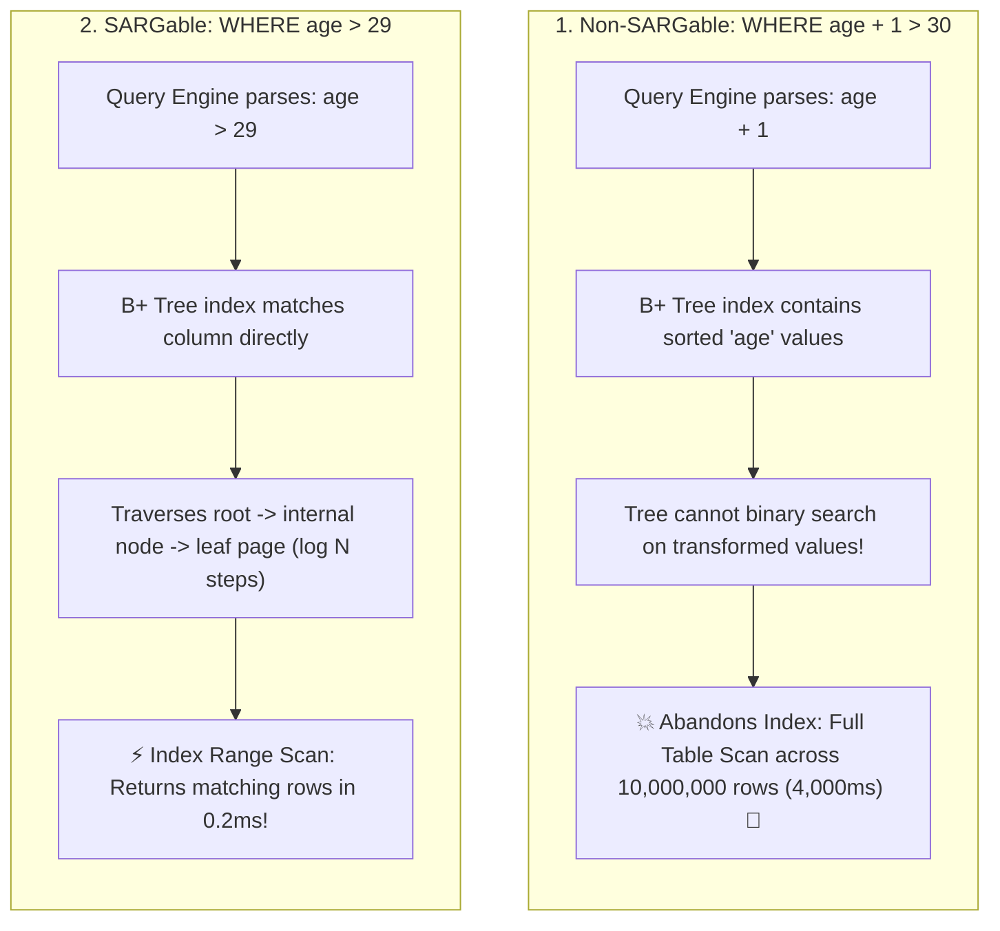

## 🎯 The Question

> **"You have a table with 10 million rows and a B+ Tree index on the column `age`. Why does `SELECT * FROM users WHERE age + 1 > 30;` take 4 seconds with a Full Table Scan, while `SELECT * FROM users WHERE age > 29;` executes in 0.2 milliseconds using the index?"**

---

## ⚡ 30-Second Elevator Pitch

Database indexes are physically organized as sorted **B+ Trees** storing raw column values:
* The B+ Tree is sorted on `age` (`[18, 19, 20, 21, ...]`), **not on `age + 1`**.
* When you write `WHERE age + 1 > 30`, the SQL engine has no precomputed index for the expression `age + 1`.
* Because SQL cannot algebraically rewrite every arbitrary function or expression, it is forced to evaluate `row.age + 1` row-by-row for all 10 million records—triggering a **Full Table Scan (Index Invalidation)**.

**The Rule**: Queries must be **SARGable (Search Argument Able)**. Never wrap the indexed column inside arithmetic operators, functions (`YEAR(date)`), or string conversions. Move all mathematical constants to the opposite side of the comparison operator:

$$\text{Rewrite: } \texttt{age + 1 > 30} \implies \texttt{age > 30 - 1} \implies \texttt{age > 29}$$

---

## 🧠 Under-the-Hood: B+ Tree Point Seek vs. Full Table Scan



---

## 🔬 Common Non-SARGable Anti-Patterns and Fixes

| Non-SARGable Anti-Pattern (Slow Full Table Scan 🐢) | SARGable Rewrite (Fast Index Seek ⚡) | Why It Fails |
| :--- | :--- | :--- |
| `WHERE age + 1 > 30` | `WHERE age > 29` | Arithmetic on indexed column |
| `WHERE YEAR(created_at) = 2026` | `WHERE created_at >= '2026-01-01' AND created_at < '2027-01-01'` | Date function strips index order |
| `WHERE LOWER(email) = 'user@test.com'` | `WHERE email = 'user@test.com'` *(or use Functional Index)* | String function masks raw characters |
| `WHERE SUBSTRING(phone, 1, 3) = '555'` | `WHERE phone LIKE '555%'` | Prefix `LIKE` is index-seekable |

---

## 📌 Comparison Matrix: Full Table Scan vs. Index Range Scan

| Metric | Non-SARGable Query (`age + 1 > 30`) | SARGable Query (`age > 29`) |
| :--- | :--- | :--- |
| **Access Path** | `type: ALL` (Full Table Scan) | `type: range` (Index Range Scan) |
| **Rows Examined** | 10,000,000 rows | Only rows matching filter criteria |
| **Disk I/O** | Gigabytes of pages read from disk/buffer pool | Reads a handful of 16 KB leaf pages |
| **Time Complexity** | $O(N)$ linear scan | $O(\log N + K)$ B+ Tree seek |
| **Execution Time** | ~2,000 – 5,000 ms | `< 1 ms` |

---

## 💡 What Interviewers Ask Next (Follow-Up Traps)

1. **"What if your application genuinely needs to filter on a function like `LOWER(email)`?"**
   - *Answer*: Use a **Functional / Expression-Based Index**. Modern databases (PostgreSQL, Oracle, MySQL 8.0+) allow indexing expressions directly:
     ```sql
     CREATE INDEX idx_users_lower_email ON users (LOWER(email));
     ```
     This instructs the database to compute `LOWER(email)` during write operations and store the lowercased strings in the B+ Tree.

2. **"Does `WHERE column * 1 = 10` invalidate an index?"**
   - *Answer*: **Yes.** Even multiplying or adding 0 forces the optimizer to treat the column reference as a general expression rather than an index seek key, bypassing standard B+ Tree navigation unless the query planner has specific algebraic simplification rules for that trivial case.

---

:::tip Placement & Interview Takeaway
**Interview Answer**: Wrapping an indexed column in an arithmetic operation (`age + 1`) makes the query non-SARGable because B+ Tree indexes store raw column values, not dynamic expressions. The engine cannot navigate the tree via binary search and falls back to a slow full table scan. Always isolate the bare column on one side of the operator.
:::

---

## 📺 Video Explanation

<YouTubeEmbed 
  id="Z-a8E_VeEaM" 
  title="Why WHERE age + 1 > 30 Kills Your Database Index | CS Interview #65" 
/>
