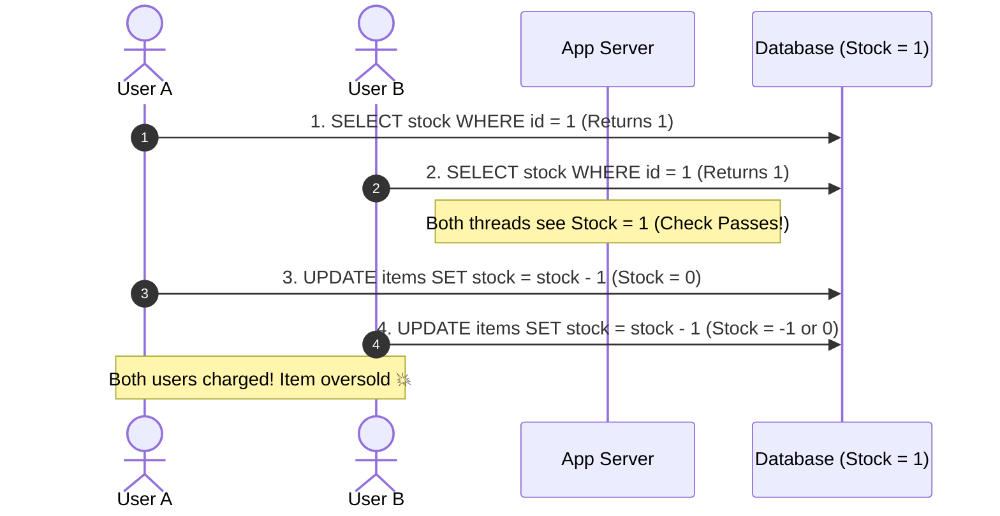

## 🎯 The Question

> **"During a high-concurrency flash sale, an item has exactly 1 unit left in stock. Two users click 'Buy Now' at the exact same millisecond. Why does a standard application allow BOTH users to purchase the item (selling 2 items with stock of 1), and how do you prevent this Lost Update race condition?"**

---

## ⚡ 30-Second Elevator Pitch

This is the classic **Read-Modify-Write Race Condition (Lost Update)**:
1. User A's thread reads stock: `SELECT stock FROM items WHERE id = 1;` $\to$ Returns `1`.
2. User B's thread reads stock at the exact same moment $\to$ Returns `1`.
3. User A verifies `1 > 0` and executes: `UPDATE items SET stock = 0 WHERE id = 1;`.
4. User B also verified `1 > 0` and executes: `UPDATE items SET stock = 0 WHERE id = 1;`.
5. Both orders are confirmed, payment gateways charge both cards, and the business accidentally oversells stock!

**The Root Cause**: Checking stock in application code and then updating it in a separate SQL statement creates a race condition window between the Read and the Write.

---

## 🧠 Under-the-Hood: The Concurrent Oversell Race Window



---

## 🔬 Production Solutions to Eliminate Overselling

### Solution 1: Atomic SQL Decrement with Guard Condition (Best & Simplest)
Eliminate the separate `SELECT`. Collapse the read and write into a single atomic SQL statement:

```sql
UPDATE inventory 
SET stock = stock - 1 
WHERE item_id = 101 AND stock >= 1;
```
* The database engine acquires an exclusive row lock on the record.
* If User A runs first, the row matches `stock >= 1`, stock becomes 0, and MySQL reports `1 row affected` (Order succeeds).
* When User B's update executes, `stock >= 1` is false, MySQL reports `0 rows affected` (Order cleanly rejected).

### Solution 2: Pessimistic Row Locking (`SELECT ... FOR UPDATE`)
```sql
BEGIN;
SELECT stock FROM inventory WHERE item_id = 101 FOR UPDATE; -- Acquires Exclusive X-Lock
-- Other transactions block here until this transaction commits!
UPDATE inventory SET stock = stock - 1 WHERE item_id = 101;
COMMIT;
```

### Solution 3: Distributed In-Memory Caching (Redis Lua Script)
In flash sales with 100,000 requests/second, databases get overwhelmed. Redis processes commands in a single-threaded event loop. A Redis Lua script checks and decrements stock in microsecond memory:

```lua
local stock = tonumber(redis.call('get', KEYS[1]))
if stock and stock > 0 then
    redis.call('decr', KEYS[1])
    return 1 -- Success
else
    return 0 -- Sold out
end
```

---

## 📌 Comparison Matrix: Oversell Prevention Strategies

| Strategy | Performance / Throughput | Implementation Complexity | Database Load | Best Use Case |
| :--- | :--- | :--- | :--- | :--- |
| **Atomic SQL Guard Clause** | ⚡ High | Very Low (1 SQL line) | Moderate | Standard e-commerce checkout |
| **`SELECT ... FOR UPDATE`** | Moderate (Thread lock queuing) | Low (Needs transaction) | High (Long lock duration) | Complex multi-item cart validation |
| **Redis Lua Scripts** | 🚀 Ultra-high (>100k req/s) | Medium | Offloads DB completely | High-velocity flash sales (Sneaker drops, tickets) |

---

## 💡 What Interviewers Ask Next (Follow-Up Traps)

1. **"What happens if payment fails after decrementing stock in Redis?"**
   - *Answer*: You must implement a **Compensating Transaction (Stock Reservation Pattern)**. Decrementing stock places the item in a temporary "Reserved" state with a 5-minute TTL. If payment succeeds, finalize the sale; if payment fails or times out, a worker increments the stock back.

2. **"Can an unsigned integer column (`stock INT UNSIGNED`) prevent overselling?"**
   - *Answer*: Yes, setting `stock INT UNSIGNED` causes MySQL to throw an error (`BIGINT UNSIGNED value is out of range`) if an update tries to push stock below 0. However, relying on database exceptions for business logic is bad practice; explicit guard clauses (`WHERE stock >= 1`) are much cleaner.

---

:::tip Placement & Interview Takeaway
**Interview Answer**: Flash sales oversell inventory because separate read and write steps create a Lost Update race condition. To prevent overselling, never check stock in application memory. Use an atomic SQL update with a guard clause (`UPDATE items SET stock = stock - 1 WHERE id = 1 AND stock >= 1`) or a single-threaded Redis Lua script.
:::

---

## 📺 Video Explanation

<YouTubeEmbed 
  id="03P4rlLLWeo" 
  title="How Flash Sales Accidentally Sell 2 Items When Stock is 1 | CS Interview #66" 
/>
