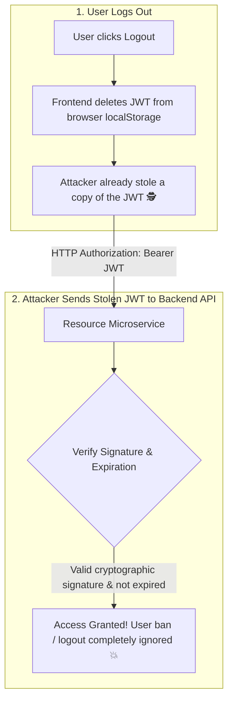

## 🎯 The Question

> **"A user clicks 'Logout', or an administrator bans a malicious user account. If your backend uses pure stateless JSON Web Tokens (JWTs), why can the attacker continue using that JWT to access protected API endpoints? Why is true token invalidation impossible without reintroducing state?"**

---

## ⚡ 30-Second Elevator Pitch

The core selling point of a **JSON Web Token (JWT)** is that it is **Stateless and Self-Contained**:
* The token contains its own payload (`sub`, `role`, `exp` expiration timestamp).
* Any microservice can verify authenticity simply by mathematically validating the cryptographic signature using a public key or secret—**with zero database queries**.

**The Fundamental Flaw**:
Because the server does not store active sessions in a database, **it has no record to delete when a user logs out**.
As long as the token signature is valid and current time is less than `exp`, **every API server in your infrastructure will accept it as authorized**.

---

## 🧠 Under-the-Hood: The Stateless Verification Trap

---

## 🔬 How Real-World Systems Invalidate JWTs

To solve this security problem in production, architectures combine stateless performance with minimal state tracking:

### 1. Short-Lived Access Tokens + Refresh Tokens (Industry Standard)
* **Access Token**: Valid for only **5 to 15 minutes**. Even if stolen, the vulnerability window is tiny.
* **Refresh Token**: Stored in a secure `HttpOnly` cookie and recorded in a database.
* To revoke access, delete the Refresh Token from the database. When the access token expires 10 minutes later, the client cannot refresh.

### 2. Redis Token Blacklisting (Deny-List)
When a user logs out, push the token's `jti` (JWT ID) into Redis with a TTL equal to the token's remaining lifespan. Services check Redis on sensitive operations.

### 3. User Token Versioning (`token_version`)
Store an integer `token_version` on the user's database record and embed it inside the JWT payload.
* When a user changes passwords or logs out, increment `user.token_version = token_version + 1`.
* During auth checks, if `jwt.token_version != user.token_version`, reject the token.

---

## 📌 Comparison Matrix: Stateless JWT vs. Stateful Sessions

| Dimension | Pure Stateless JWT | Stateful Session (Redis / DB) | Hybrid (Short JWT + Refresh Token) |
| :--- | :--- | :--- | :--- |
| **Instant Revocation** | ❌ Impossible | ✅ Instant (Delete session key) | ✅ Revocation within 5–15 mins |
| **Database Load** | ⚡ Zero DB lookups | Requires lookup per request | Lookup only on token refresh |
| **Payload Size** | Large (~500–1000 bytes in headers) | Tiny (~32-byte session ID cookie) | Small access token |
| **Stolen Token Risk** | Valid until `exp` timestamp | Revocable immediately | Bounded to short lifespan |

---

## 💡 What Interviewers Ask Next (Follow-Up Traps)

1. **"If we use a Redis Blacklist for JWTs, haven't we just reinvented sessions?"**
   - *Answer*: **Yes, partially.** You sacrifice pure statelessness. However, a blacklist is much smaller than a full session store: it only stores tokens for logged-out or banned users (a small fraction of traffic), rather than storing a session for every single active user in the system.

2. **"Why shouldn't you store JWTs in browser `localStorage`?"**
   - *Answer*: Any JavaScript running on the page can access `localStorage`. If your app has a Cross-Site Scripting (XSS) vulnerability, an injected script can steal the JWT. Store authentication tokens in **`HttpOnly`, `Secure`, `SameSite=Strict` cookies** so browser JavaScript cannot read them.

---

:::tip Placement & Interview Takeaway
**Interview Answer**: Pure JWTs cannot be invalidated on demand because they are stateless. Resource servers verify tokens purely by checking the cryptographic signature without querying a central session database. Real-world systems solve this by pairing short-lived access tokens (10 mins) with revocable refresh tokens, token versioning, or Redis blacklists.
:::

---

## 📺 Video Explanation

<YouTubeEmbed 
  id="fPMGKsCvQB0" 
  title="Why You CANNOT Truly Invalidate a JWT | CS Interview #67" 
/>
