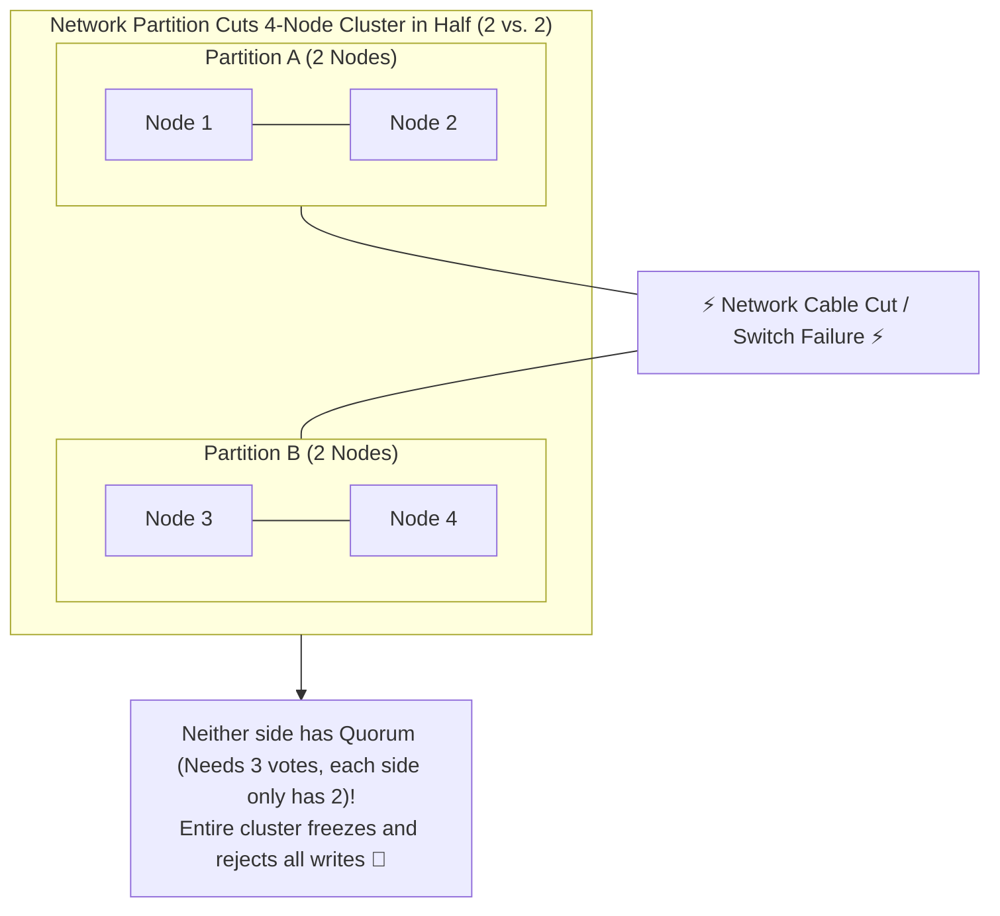

## 🎯 The Question

> **"In distributed systems like ZooKeeper, etcd, and Kafka Raft, why do production engineers always deploy an ODD number of nodes (3, 5, or 7)? Why does deploying 4 nodes provide zero additional fault tolerance over 3 nodes while making the cluster worse?"**

---

## ⚡ 30-Second Elevator Pitch

Distributed consensus engines (Raft, Paxos) rely on **Quorum** to ensure that all cluster members agree on leader election and state machine updates without data divergence.

The formula for Quorum (majority agreement) is:
$$Q = \left\lfloor \frac{N}{2} \right\rfloor + 1$$

* **For $N = 3$ nodes**: Quorum is $\lfloor 3/2 \rfloor + 1 = \mathbf{2}$. The cluster can tolerate **1 failure** ($3 - 2 = 1$).
* **For $N = 4$ nodes**: Quorum is $\lfloor 4/2 \rfloor + 1 = \mathbf{3}$. The cluster can still only tolerate **1 failure** ($4 - 3 = 1$)!

Deploying 4 nodes costs more money, increases network consensus latency, and **provides the exact same fault tolerance (1 node failure) as 3 nodes**. Even worse: a clean 50-50 network partition in a 4-node cluster creates an irrecoverable **Split-Brain deadlock**.

---

## 🧠 Under-the-Hood: Network Partition and Split-Brain in a 4-Node Cluster

In a 3-node cluster cut by a partition:
* Side A has 2 nodes $\implies$ Has Quorum ($2 \ge 2$), elects a leader, and continues operating!
* Side B has 1 node $\implies$ Steps down safely. Zero deadlock.

---

## 🔬 Mathematical Fault Tolerance Proof

The maximum number of allowable node failures ($F$) for a cluster of size $N$ is:
$$F = \left\lfloor \frac{N - 1}{2} \right\rfloor$$

| Cluster Size ($N$) | Required Quorum ($Q$) | Tolerable Failures ($F$) | Extra Resilience Gained? |
| :---: | :---: | :---: | :--- |
| **1** | 1 | 0 | None (Single Point of Failure) |
| **3** | **2** | **1** | ✅ Tolerates 1 node failure |
| **4** | **3** | **1** | ❌ **Zero gain! (Same as 3 nodes, but higher cost & risk)** |
| **5** | **3** | **2** | ✅ Tolerates 2 node failures |
| **6** | **4** | **2** | ❌ **Zero gain! (Same as 5 nodes)** |
| **7** | **4** | **3** | ✅ Tolerates 3 node failures |

---

## 📌 Comparison Matrix: 3-Node vs. 4-Node Distributed Cluster

| Dimension | 3-Node Cluster | 4-Node Cluster |
| :--- | :--- | :--- |
| **Quorum Needed** | 2 of 3 nodes | 3 of 4 nodes |
| **Node Failures Tolerated** | 1 node | 1 node (Zero improvement!) |
| **Hardware / Cloud Cost** | $1\times$ baseline | $+33\%$ higher cloud bill |
| **50-50 Network Partition** | Impossible (Partitions into 2 vs 1) | **High Risk** (Partitions into 2 vs 2 deadlock) |
| **Write Consensus Latency** | Faster (Wait for 2 ACKs) | Slower (Must wait for 3 ACKs across network) |

---

## 💡 What Interviewers Ask Next (Follow-Up Traps)

1. **"What is a Split-Brain scenario, and why is it dangerous?"**
   - *Answer*: Split-brain occurs when a network failure divides a cluster into isolated groups that each believe the other is dead. If both sides were permitted to elect a leader and accept writes without a majority quorum, data would diverge incompatibly, corrupting databases and causing irreversible data loss.

2. **"Why don't we deploy 21 nodes for maximum fault tolerance?"**
   - *Answer*: Because of **Consensus Overhead**. In Raft/Paxos, the leader must replicate log entries and collect ACKs from a quorum. With 21 nodes, quorum is 11 nodes. Coordinating network round-trips across 11 machines introduces massive tail latency. Production systems rarely exceed 5 or 7 nodes.

---

:::tip Placement & Interview Takeaway
**Interview Answer**: Always deploy an odd number of nodes in distributed consensus clusters. Consensus requires a strict majority quorum $Q = \lfloor N/2 \rfloor + 1$. A 4-node cluster requires 3 nodes for quorum, meaning it can only survive 1 failure—identical to a 3-node cluster. An even number of nodes increases cost and introduces 50-50 split-brain deadlocks with zero resilience benefit.
:::

---

## 📺 Video Explanation

<YouTubeEmbed 
  id="HYw-R9eBFXM" 
  title="Why You Should NEVER Deploy 4 Nodes in a Cluster | CS Interview #68" 
/>
