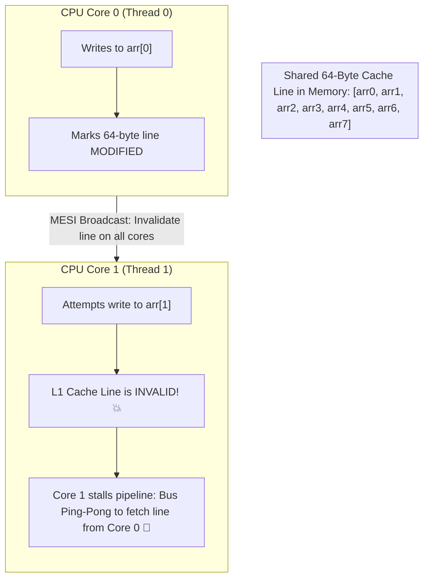

## 🎯 The Question

> **"You have an 8-core CPU and spawn 8 threads to increment independent elements in an array (`arr[thread_id]++`). Instead of executing 8 times faster, the code runs SLOWER than a single thread! Why does multithreading collapse performance on independent variables?"**

---

## ⚡ 30-Second Elevator Pitch

Developers assume that because each thread updates its own independent variable (`arr[0]`, `arr[1]`, `arr[2]`), there is zero contention.

At the silicon hardware level, CPUs **never read or write individual bytes from RAM**. CPUs fetch memory in **64-byte Cache Lines**:
* An array of 8 integers (`int` = 4 bytes) occupies only $8 \times 4 = 32\text{ bytes}$—meaning the entire array fits inside a **single 64-byte L1 Cache Line**.
* When Core 0 writes to `arr[0]`, the hardware **MESI Cache Coherence Protocol** marks the entire 64-byte line as `Modified` on Core 0 and **`Invalid` on all other 7 cores**.
* When Core 1 attempts to update `arr[1]`, its L1 cache triggers a **Cache Miss**. It must stall execution, force Core 0 to flush its cache line to L3/RAM, and re-fetch the data.

This devastating cycle is called **False Sharing**: threads share zero program variables, but share the same physical hardware cache line!

---

## 🧠 Under-the-Hood: The MESI Cache Invalidation Bouncing Ping-Pong



---

## 🔬 How to Fix False Sharing: Cache Line Padding

To restore $8\times$ linear speedup, ensure each thread's variable resides on its **own dedicated 64-byte cache line**:

```cpp
// ❌ FALSE SHARING BUG: All 8 counters fit in ONE 64-byte line
int counters[8]; 

// ✅ PRODUCTION FIX: Pad each element to 64 bytes
struct alignas(64) PaddedCounter {
    int value;
    // Compiler pads struct with 60 bytes of empty space
};

PaddedCounter counters[8]; // Each counter occupies its own independent cache line!
```

In Java, the JDK provides the **`@Contended`** annotation (`sun.misc.Contended`), which automatically injects 128 bytes of padding around fields (used in `LongAdder` and `ConcurrentHashMap`).

---

## 📌 Comparison Matrix: False Sharing vs. True Data Sharing

| Dimension | True Data Sharing | False Sharing |
| :--- | :--- | :--- |
| **What is Shared?** | Same program variable (e.g. `shared_counter++`) | Different variables that happen to share a 64-byte cache line |
| **Program Bug Type** | Logic race condition (Incorrect answer) | Pure performance collapse (Correct answer, $10\times$ slower) |
| **Detection Method** | Compiler warnings / Mutex requirements | Hardware performance profilers (`perf c2c` / VTune) |
| **Hardware Mechanism** | Lock contention / Atomic CAS retries | **MESI Cache Line Invalidation Ping-Pong** |
| **The Fix** | Mutex, Spinlock, or Atomic instructions | Cache Line Padding (`alignas(64)` / `@Contended`) |

---

## 💡 What Interviewers Ask Next (Follow-Up Traps)

1. **"What is the difference between `AtomicInteger` and `LongAdder` in Java?"**
   - *Answer*: In high-concurrency environments, all threads executing `AtomicInteger.incrementAndGet()` fight over the same single memory address, causing CAS loop retries. **`LongAdder`** maintains an internal array of cell counters where each cell is padded with `@Contended` to prevent false sharing. Threads hash to different cells and sum them up upon retrieval, scaling linearly with thread count.

2. **"How do you detect False Sharing in Linux production systems?"**
   - *Answer*: Use Linux perf tools:
     ```bash
     perf c2c record ./my_multithreaded_app
     perf c2c report
     ```
     `perf c2c` (Cache-to-Cache) identifies specific data structures that trigger high rates of Remote HITM (Hit Modified) cache line transfers between CPU sockets.

---

:::tip Placement & Interview Takeaway
**Interview Answer**: Running 8 threads on 8 cores can run slower than a single thread due to False Sharing. Modern CPUs synchronize memory in 64-byte cache lines. If threads update adjacent variables located on the same cache line, the MESI protocol repeatedly invalidates the cache across cores, turning fast L1 memory access into slow inter-core bus ping-pong.
:::

---

## 📺 Video Explanation

<YouTubeEmbed 
  id="PC20XmRCCh0" 
  title="Why 8-Core CPUs FAIL With 8 Threads | CS Interview #69" 
/>
