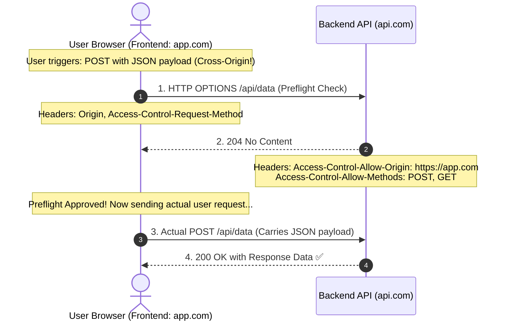

## 🎯 The Question

> **"You build a backend REST API. When testing endpoints in Postman, curl, or your terminal, every request succeeds with `200 OK`. But the moment your frontend React app calls the exact same URL, the browser blocks the response with a red CORS error! Why doesn't Postman enforce CORS, and why do browsers?"**

---

## ⚡ 30-Second Elevator Pitch

The fundamental revelation is that **CORS is a Browser-Enforced Security Mechanism**, not a backend firewall:
* Postman and curl are standalone developer tools. They do not store a user's logged-in banking session cookies or authenticate arbitrary third-party website scripts.
* Web browsers execute **untrusted JavaScript** downloaded from arbitrary websites across the internet.

Without the browser's **Same-Origin Policy (SOP)**:
1. You visit a malicious website: `evil-attacker.com`.
2. That page runs a hidden background script: `fetch('https://yourbank.com/api/transfer-funds')`.
3. Because you are logged into your bank, the browser would automatically attach your authenticated banking cookies, transferring your money without your consent!

To stop this, browsers enforce CORS: if your frontend (`localhost:3000`) tries to call an API on another domain (`api.myapp.com`), the browser blocks the response unless the backend explicitly sends the header:
```http
Access-Control-Allow-Origin: http://localhost:3000
```

---

## 🧠 Under-the-Hood: The Browser Preflight (OPTIONS) Handshake



---

## 🔬 What Defines an "Origin"?

Two URLs share the **Same Origin** if and only if all three match:
$$\mathbf{Protocol} \ + \ \mathbf{Domain / Host} \ + \ \mathbf{Port}$$

| URL Comparison against `https://api.domain.com:443` | Same Origin? | Reason |
| :--- | :---: | :--- |
| `https://api.domain.com/users` | ✅ **Yes** | Protocol, host, and default 443 port match |
| `http://api.domain.com/users` | ❌ **No** | Protocol mismatch (`http` vs `https`) |
| `https://domain.com/users` | ❌ **No** | Subdomain mismatch (`api.domain.com` vs `domain.com`) |
| `https://api.domain.com:8080/users` | ❌ **No** | Port mismatch (`8080` vs `443`) |

---

## 📌 Comparison Matrix: Postman / cURL vs. Web Browsers

| Dimension | Postman / cURL CLI | Web Browser |
| :--- | :--- | :--- |
| **Environment** | Controlled developer environment | Untrusted sandbox executing arbitrary web JS |
| **Same-Origin Policy** | ❌ None | ✅ Strictly enforced |
| **Auto-Attach Cookies** | No (Unless manually provided) | ✅ Automatically attaches ambient session cookies |
| **Preflight (OPTIONS)** | Never sends preflight | Sends preflight on non-simple requests |
| **Who Blocks the Request?**| Nobody | **The Browser client-side engine blocks the response** |

---

## 💡 What Interviewers Ask Next (Follow-Up Traps)

1. **"Does a CORS error mean the request never reached the server?"**
   - *Answer*: **No! This is a massive trap.** For simple requests (like standard `GET` requests), the browser *actually sends the request and the server executes it*! The server computes the database query and responds with data. When the response reaches the browser, the browser inspects the missing `Access-Control-Allow-Origin` header and **hides the response from JavaScript**. The write operation already succeeded on the backend!

2. **"Why is `Access-Control-Allow-Origin: *` dangerous with authenticated APIs?"**
   - *Answer*: Using wildcard `*` allows any website on the internet to read API responses. Furthermore, the browser standard **strictly forbids wildcard origins when `Access-Control-Allow-Credentials: true` is enabled**. If you send cookies, you must specify the exact, explicit origin URL.

---

:::tip Placement & Interview Takeaway
**Interview Answer**: Postman works because it is a direct HTTP client that does not execute untrusted third-party scripts or attach browser cookies. Browsers enforce the Same-Origin Policy to protect users from malicious sites stealing data or triggering unauthorized actions. The backend must explicitly authorize the frontend domain via `Access-Control-Allow-Origin` headers.
:::

---

## 📺 Video Explanation

<YouTubeEmbed 
  id="sjv1ZbnBVB8" 
  title="Why Postman Works But Browsers Block Your API | CS Interview #70" 
/>
