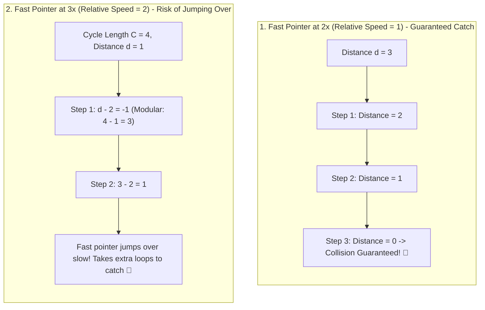

## 🎯 The Question

> **"In Floyd's Tortoise and Hare cycle detection algorithm, the slow pointer moves 1 step per iteration (`slow = slow.next`) while the fast pointer moves 2 steps (`fast = fast.next.next`). Why does the fast pointer move at EXACTLY 2x speed? What happens mathematically if the fast pointer moves at 3x or 4x speed?"**

---

## ⚡ 30-Second Elevator Pitch

The entire mathematical proof of cycle detection relies on **Relative Velocity**:
* When slow moves at speed $1$ and fast moves at speed $2$:
  $$\text{Relative Speed} = 2 - 1 = \mathbf{1\text{ step per iteration}}$$
* Inside a cycle of length $C$, let the initial distance between fast and slow be $d$ nodes.
* On every iteration, the gap between them closes by **exactly 1 node**:
  $$d \longrightarrow d - 1 \longrightarrow d - 2 \longrightarrow \dots \longrightarrow 0$$
* Because integers decrement by 1, the distance is **mathematically guaranteed to hit 0**. The fast pointer can never "jump over" the slow pointer.

**Why Not 3x Speed?**
If fast moves at speed 3, relative speed is $3 - 1 = 2$.
On every iteration, distance shrinks by 2: $d \to d - 2$. If the cycle length $C$ is even and initial distance is odd, the fast pointer can **jump over the slow pointer forever**, looping multiple times before colliding and needlessly increasing time complexity.

---

## 🧠 Under-the-Hood: Distance Closing Inside the Cycle

---

## 🔬 Mathematical Proof: Cycle Entry Point

Beyond detecting a cycle, moving at $2\times$ provides the elegant mathematical foundation for finding the **Cycle Entry Node**:

Let:
* $L$ = Distance from head to cycle start.
* $C$ = Cycle perimeter length.
* $x$ = Distance from cycle start to meeting point.

At collision:
* $\text{Distance}_{\text{slow}} = L + x$
* $\text{Distance}_{\text{fast}} = L + x + kC$ (where $k \ge 1$ complete loops)

Since fast traveled exactly twice as far:
$$2(L + x) = L + x + kC \implies L + x = kC \implies \mathbf{L = kC - x}$$

This means:
If you place one pointer at the **head** and keep one pointer at the **meeting point**, and advance **both at speed 1**, they will traverse distance $L$ and **collide at the exact cycle start node**! This mathematical property fails if fast speed is anything other than $2\times$.

---

## 📌 Comparison Matrix: Fast Pointer Speeds in Cycle Detection

| Fast Pointer Speed | Relative Velocity ($\Delta v$) | Distance Sequence Modulo $C$ | Guaranteed Collision in 1 Lap? | Finds Cycle Entry Node? |
| :---: | :---: | :--- | :---: | :---: |
| **2x (Optimal)** | **1 node / step** | $d, d-1, d-2, \dots, 0$ | ✅ **Yes (Guaranteed)** | ✅ **Yes ($L = kC - x$)** |
| **3x** | 2 nodes / step | $d, d-2, d-4, \dots$ | ❌ No (Can skip if $C$ is even) | ❌ Complex modular math |
| **4x** | 3 nodes / step | $d, d-3, d-6, \dots$ | ❌ No (Can skip if $\gcd(3, C) \neq 1$) | ❌ Fails |

---

## 💡 What Interviewers Ask Next (Follow-Up Traps)

1. **"What is the maximum number of steps before slow and fast meet in a cycle of length $C$?"**
   - *Answer*: At most **$C$ iterations** after the slow pointer enters the cycle. Because distance shrinks by 1 node per step and initial distance cannot exceed $C - 1$, they are guaranteed to meet in $\le C$ steps, keeping runtime strictly $O(N)$ with $O(1)$ auxiliary memory.

2. **"Can Floyd's Cycle algorithm be applied to arrays without pointers?"**
   - *Answer*: Yes! This is the standard solution for **LeetCode 287 (Find the Duplicate Number)** in an array of $n + 1$ integers in range $[1, n]$. By treating each array value as a pointer to the next index (`next = arr[curr]`), duplicate numbers create a cycle that can be detected in $O(N)$ time and $O(1)$ space.

---

:::tip Placement & Interview Takeaway
**Interview Answer**: Fast moves at exactly 2x speed so the relative speed between pointers is $2 - 1 = 1$. A relative speed of 1 guarantees that the gap between pointers shrinks by exactly one node every step, ensuring the fast pointer cannot jump over the slow pointer and enabling the classic $L = kC - x$ mathematical proof to locate the cycle entrance.
:::

---

## 📺 Video Explanation

<YouTubeEmbed 
  id="xVJk5gI4MSc" 
  title="Why Fast Pointer Moves at EXACTLY 2x | CS Interview #71" 
/>
