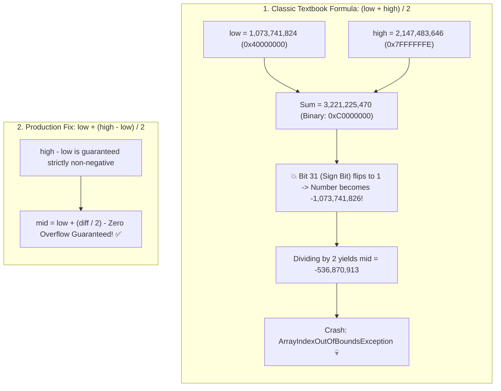

## 🎯 The Question

> **"For decades, computer science textbooks taught binary search using the formula `mid = (low + high) / 2`. In 2006, Google research engineer Joshua Bloch revealed that this code contained a catastrophic bug that sat undiscovered in Java's standard library (`java.util.Arrays`) for 9 years. What is the bug, and how do you write bug-free binary search?"**

---

## ⚡ 30-Second Elevator Pitch

In 32-bit signed two's complement integer arithmetic (used in C, C++, and Java):
* The maximum value a 32-bit signed integer can hold is:
  $$\text{Integer.MAX\_VALUE} = 2^{31} - 1 = \mathbf{2{,}147{,}483{,}647}$$
* In large arrays (e.g. over 1 billion elements), when search bounds reach:
  $$\text{low} = 1{,}073{,}741{,}824 \quad \text{and} \quad \text{high} = 2{,}147{,}483{,}646$$
* The sum exceeds the 32-bit integer boundary:
  $$\text{low} + \text{high} = 3{,}221{,}225{,}470 > 2^{31} - 1$$

In two's complement, this **overflows into the sign bit**, turning into a **negative number** (`-1,073,741,826`).
Dividing by 2 yields a negative index (`mid = -536,870,913`), which immediately crashes with an `ArrayIndexOutOfBoundsException`!

---

## 🧠 Under-the-Hood: 32-Bit Signed Integer Overflow



---

## 🔬 The 3 Production Fixes

### Fix 1: Subtraction-First Formula (Industry Standard)
Instead of adding two large numbers, subtract them:

```java
int mid = low + (high - low) / 2;
```
Because `high >= low`, `high - low` is guaranteed to be non-negative and smaller than `high`, eliminating all possibility of integer overflow.

### Fix 2: Unsigned Bit-Shift Operator (Fastest in Java)
Java's standard library fixed the bug using the **unsigned right shift (`>>>`)**:

```java
int mid = (low + high) >>> 1;
```
Even if `low + high` overflows and turns negative in signed interpretation, `>>> 1` treats the 32 bits as an **unsigned 32-bit integer**, shifting the sign bit to 0 and calculating the exact intended midpoint in a single CPU cycle!

### Fix 3: 64-Bit Promotion
In C/C++:
```cpp
int mid = ((long long)low + high) / 2;
```

---

## 📌 Comparison Matrix: Midpoint Formulas

| Formula | Overflow Safety | CPU Execution Cost | Language Portability |
| :--- | :---: | :---: | :--- |
| `(low + high) / 2` | ❌ **Crashes on large arrays** | 1 Add + 1 Div | Universal |
| `low + (high - low) / 2` | ✅ **100% Safe** | 1 Sub + 1 Div + 1 Add | Universal (C++, Java, Python, Go) |
| `(low + high) >>> 1` | ✅ **100% Safe** | ⚡ 1 Add + 1 Logical Shift | Java, JS (Requires unsigned shift operator) |
| `low + ((high - low) >> 1)` | ✅ **100% Safe** | ⚡ 1 Sub + 1 Shift + 1 Add | Universal (Mind operator precedence!) |

---

## 💡 What Interviewers Ask Next (Follow-Up Traps)

1. **"Why didn't anyone catch this bug in Java for 9 years?"**
   - *Answer*: Because in the 1990s and early 2000s, computers rarely had more than 256 MB to 512 MB of physical RAM. Allocating an array of 1 billion integers requires **4 GB of contiguous memory**, which was impossible on 32-bit hardware. The bug only surfaced when 64-bit systems with tens of gigabytes of RAM became mainstream.

2. **"Does Python have this binary search overflow bug?"**
   - *Answer*: **No.** Python 3 integers have **arbitrary precision (bignums)** and dynamically allocate memory to hold arbitrarily large values. `(low + high) // 2` never overflows in Python, though `low + (high - low) // 2` remains good algorithmic practice for portability across languages.

---

:::tip Placement & Interview Takeaway
**Interview Answer**: `(low + high) / 2` overflows when `low + high` exceeds $2^{31} - 1$, flipping the sign bit in two's complement and producing a negative midpoint index. In production code, always calculate the midpoint using `low + (high - low) / 2` or `(low + high) >>> 1` to guarantee overflow safety.
:::

---

## 📺 Video Explanation

<YouTubeEmbed 
  id="3XcfKVnij68" 
  title="The Bug That Broke Java for 9 Years | CS Interview #72" 
/>
