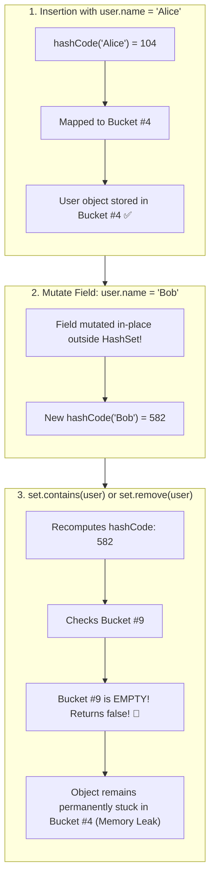

## 🎯 The Question

> **"You create a custom class `User`, insert an instance into a `HashSet<User>`, and verify `set.contains(user)` returns `true`. Then, you modify one field (`user.name = 'Bob'`). Why does `set.contains(user)` suddenly return `false`, and why does calling `set.remove(user)` fail to delete it, creating a permanent memory leak?"**

---

## ⚡ 30-Second Elevator Pitch

A `HashSet` (and `HashMap`) relies on the **Immutability of Hash Codes**:
1. When you call `set.add(user)`, the set computes `user.hashCode()`, determines the bucket index (e.g. Bucket #4), and places the object in that bucket.
2. If you mutate a field participating in `hashCode()`, the object's hash code **changes dynamically**.
3. When you later call `set.contains(user)` or `set.remove(user)`, the set calculates the **new hash code** and looks in a completely different bucket (e.g. Bucket #9).
4. Bucket #9 is empty! The set reports `false` (object not found), even though the exact instance is still sitting right inside Bucket #4.

The object becomes an unreachable **"Ghost Object"**—it cannot be retrieved, cannot be deleted, and permanently leaks memory!

---

## 🧠 Under-the-Hood: The Displaced Hash Bucket Trap



---

## 🔬 The Golden Rule: The hashCode() and equals() Contract

Java's official language specification mandates:
* If two objects are equal according to `equals()`, they **must have identical `hashCode()` values**.
* **Hash Code Invariant**: The value returned by `hashCode()` must remain **strictly consistent** throughout the lifetime of the application as long as the object is stored inside a hash-based collection.

### Production Solution: Enforce Immutable Keys
Never use mutable domain classes as keys in HashMaps or elements in HashSets. Use immutable data carriers:
* **Java**: `record` or `final` fields without setters:
  ```java
  public record UserKey(String id, String email) {} // Immutable by design!
  ```
* **Python**: Use immutable tuples or frozen dataclasses (`@dataclass(frozen=True)`).
* **C++**: Mark key members `const`.

---

## 📌 Comparison Matrix: Mutable vs. Immutable Hash Keys

| Dimension | Mutable Key (e.g. standard JavaBean / POJO) | Immutable Key (e.g. Java `record` / frozen class) |
| :--- | :--- | :--- |
| **`hashCode()` Consistency** | ❌ Changes whenever fields mutate | ✅ 100% Guaranteed constant throughout lifecycle |
| **Lookups After Field Update** | 💥 Returns `false` (Ghost Object) | Fields cannot be mutated; lookups always succeed |
| **Deletion via `remove()`** | ❌ Fails (Permanent heap memory leak) | ✅ Always locates correct bucket and deletes |
| **Thread Safety** | Prone to data races | Inherently thread-safe |

---

## 💡 What Interviewers Ask Next (Follow-Up Traps)

1. **"What happens if you iterate over the HashSet with a `for` loop after mutating the object?"**
   - *Answer*: The loop **will find the object**! Iterators do not compute hash codes; they iterate linearly through all buckets. However, `set.contains()` and `set.remove()` will still fail. This discrepancy creates confusing bugs where a set prints an element on screen, but claims it doesn't contain it when checked!

2. **"Why should you only use ID fields in `hashCode()` instead of all object attributes?"**
   - *Answer*: If an entity has a unique immutable identifier (like `UUID id`), base `hashCode()` and `equals()` **solely on that immutable ID**. That way, mutable attributes (like `userName` or `lastLogin`) can update freely without changing the object's hash code or bucket position.

---

:::tip Placement & Interview Takeaway
**Interview Answer**: Modifying an object after inserting it into a HashSet changes its `hashCode`. Subsequent lookups compute the new hash and check the wrong bucket, failing to find the object and preventing deletion. Always use immutable types (like Java records or frozen dataclasses) for keys in hash-based collections.
:::

---

## 📺 Video Explanation

<YouTubeEmbed 
  id="9nttE0UaDoU" 
  title="Why HashSet Can't Find Your Object | CS Interview #73" 
/>
