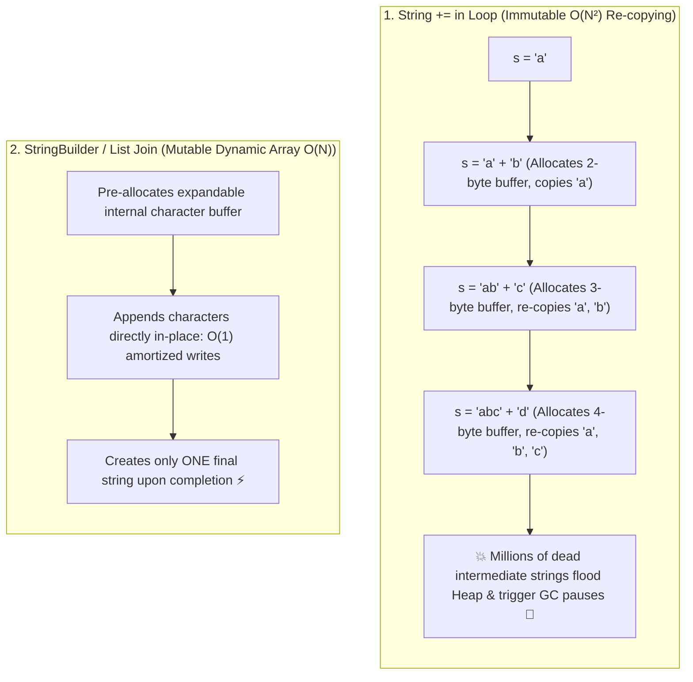

## 🎯 The Question

> **"In Java, Python, and JavaScript, appending strings inside a loop using `s += item;` appears to be an innocent $O(N)$ loop. Why does concatenating 100,000 strings this way cause application execution to grind to a halt and consume gigabytes of garbage-collected RAM?"**

---

## ⚡ 30-Second Elevator Pitch

In high-level languages (Java, Python, JavaScript, C#), **Strings are strictly Immutable**:
* Once created in memory, a string's underlying character array **can never be modified in-place**.
* When you write `s += item`, the runtime **does not append characters** to the existing memory buffer.
* Instead, it:
  1. Allocates a **brand-new string object** on the heap of size $\text{len}(s) + \text{len}(item)$.
  2. Copies **all existing characters** of $s$ into the new buffer.
  3. Copies the new $item$ characters.
  4. Abandons the old string object to be collected by Garbage Collection.

If a loop runs $N$ times, iteration $i$ copies $i$ characters. Total work performed is:
$$1 + 2 + 3 + \dots + N = \frac{N(N + 1)}{2} = \mathbf{O(N^2)}$$

Concatenating 100,000 strings copies over **5 billion characters** and generates millions of temporary heap garbage objects!

---

## 🧠 Under-the-Hood: O(N²) Repeated Memory Allocations



---

## 🔬 Production Solution: Mutable Buffers and Array Joins

### Java: `StringBuilder`
```java
// ❌ DANGEROUS: O(N^2) time & memory
String result = "";
for (String s : list) { result += s; }

// ✅ PRODUCTION: O(N) linear time
StringBuilder sb = new StringBuilder();
for (String s : list) { sb.append(s); }
String result = sb.toString();
```

### Python: `''.join(list)`
```python
# ❌ DANGEROUS: Repeated string recreation
res = ""
for w in words: res += w

# ✅ PRODUCTION: Single pass memory allocation
res = "".join(words)
```
Python's `''.join()` calculates the total length of all strings in a single initial pass, allocates **exactly one memory buffer of the precise total size**, and copies each string into place in $O(N)$ linear time.

---

## 📌 Comparison Matrix: String += vs. StringBuilder / Join

| Metric | `String +=` (Immutable Loop) | `StringBuilder` / `''.join()` |
| :--- | :--- | :--- |
| **Time Complexity** | 🐢 $O(N^2)$ Quadratic | ⚡ **$O(N)$ Linear** |
| **Heap Allocations** | $N$ separate string objects | 1 internal resizable buffer + 1 final string |
| **Garbage Collector Load** | Severe (Triggers frequent GC stop-the-world pauses) | Minimal (Near zero heap garbage) |
| **100,000 Iterations** | ~15 to 45 seconds | **~4 milliseconds** ($10{,}000\times$ faster!) |

---

## 💡 What Interviewers Ask Next (Follow-Up Traps)

1. **"Doesn't the modern Java compiler automatically optimize `+` to `StringBuilder`?"**
   - *Answer*: **Only for single-line expressions**, like `String s = a + b + c;`. The compiler replaces this single line with `new StringBuilder().append(a).append(b).append(c).toString()`. However, **inside a loop**, the compiler creates a brand-new `StringBuilder` on *every single iteration*, completely failing to solve the $O(N^2)$ re-allocation problem!

2. **"What is the difference between `StringBuilder` and `StringBuffer` in Java?"**
   - *Answer*: `StringBuffer` is **synchronized** (thread-safe) using method-level locks, introducing mutex locking overhead on every call. `StringBuilder` is **unsynchronized** (not thread-safe), making it significantly faster for local loop operations.

---

:::tip Placement & Interview Takeaway
**Interview Answer**: String concatenation in loops creates $O(N^2)$ complexity because strings are immutable. Each `+=` allocates a new memory buffer and re-copies all previous characters. Always use mutable buffers like Java's `StringBuilder` or Python's `''.join()` to append characters in $O(N)$ linear time.
:::

---

## 📺 Video Explanation

<YouTubeEmbed 
  id="2-_VM0FObHg" 
  title="Why String += in Loops Kills Your Code | CS Interview #74" 
/>
