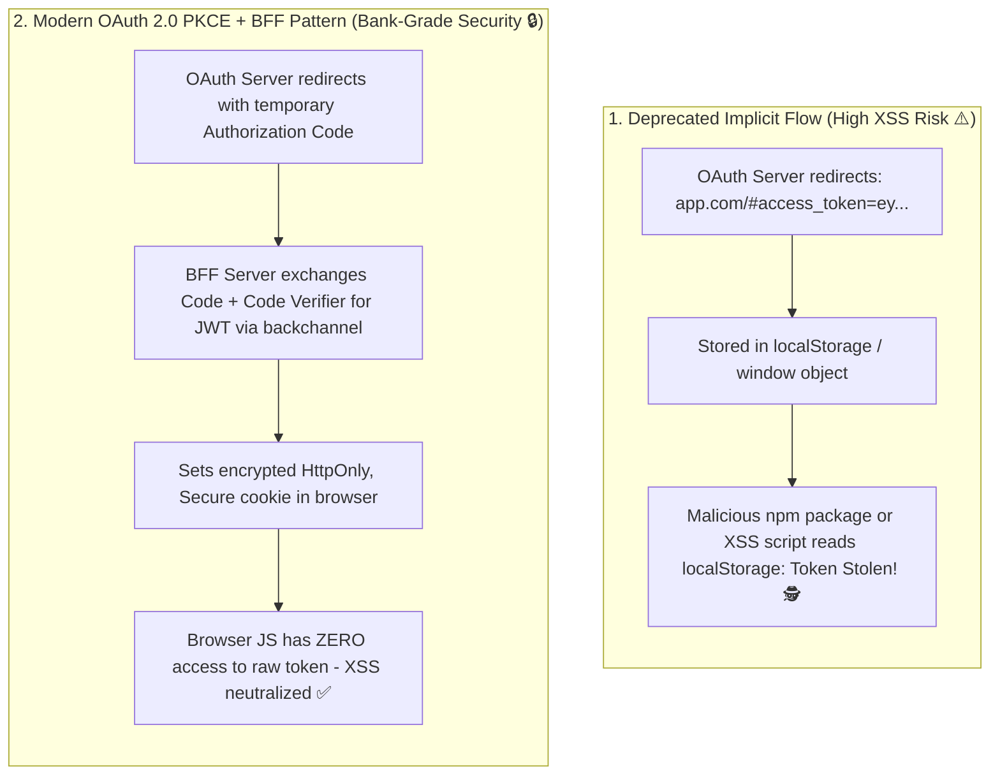

## 🎯 The Question

> **"In legacy OAuth tutorials, authentication servers redirect back to single-page applications with the Access Token directly in the URL hash (`Implicit Flow`). Why did the IETF deprecate this flow, and why does Google never expose raw access tokens directly to browser JavaScript?"**

---

## ⚡ 30-Second Elevator Pitch

A web browser is an **Untrusted Public Client**:
* Any script running on the page (third-party analytics, npm dependencies, advertising widgets, browser extensions, or injected XSS scripts) has full read access to `localStorage`, `sessionStorage`, and global JavaScript variables.
* If an OAuth server passes a raw access token directly to the browser, **a single Cross-Site Scripting (XSS) vulnerability allows an attacker to exfiltrate the token** and impersonate the user indefinitely.

**The Modern Security Architecture**:
1. **OAuth 2.0 with PKCE (Proof Key for Code Exchange)** replaces the deprecated Implicit Flow. The browser only receives an ephemeral, one-time **Authorization Code**.
2. **Backend-for-Frontend (BFF) Pattern**: The authorization code is exchanged for tokens **on the server backend** via secure backchannel.
3. The raw JWT never touches the browser; the backend sets an **encrypted, `HttpOnly`, `SameSite=Strict` session cookie** that JavaScript cannot access.

---

## 🧠 Under-the-Hood: Implicit Flow Vulnerability vs. Authorization Code + PKCE

---

## 🔬 How PKCE (Proof Key for Code Exchange) Works

PKCE protects public clients against authorization code interception attacks without requiring a client secret:

1. **Client generates a secret**: Creates a cryptographically random string called the **Code Verifier** ($43\text{–}128$ characters).
2. **Calculates Code Challenge**: Computes `Challenge = Base64URL(SHA256(Verifier))`.
3. **Authorization Request**: Sends `Challenge` to OAuth server with `response_type=code`.
4. **Token Exchange**: When the backend exchanges the returned authorization code, it sends the raw **Code Verifier**.
5. The OAuth server hashes the verifier with SHA-256 and checks if it matches the challenge. Even if an attacker steals the code from browser history, they cannot redeem it without the original verifier!

---

## 📌 Comparison Matrix: OAuth Implicit Flow vs. PKCE with BFF

| Dimension | Legacy Implicit Flow (Deprecated) | Authorization Code + PKCE with BFF |
| :--- | :--- | :--- |
| **Token in Browser URL** | ❌ Yes (Appeared in URL hash fragments) | ❌ **Never** (Only ephemeral auth code) |
| **Token Storage** | `localStorage` / `sessionStorage` | Stored on server; browser holds `HttpOnly` cookie |
| **XSS Vulnerability** | 💥 Critical (Attacker can steal raw JWT) | 🛡️ Protected (JS cannot read `HttpOnly` cookies) |
| **Refresh Token Support** | ❌ No (Cannot safely store refresh tokens) | ✅ Supported securely on BFF backend |
| **IETF Specification** | Officially deprecated in OAuth 2.1 | Mandatory standard for all public apps |

---

## 💡 What Interviewers Ask Next (Follow-Up Traps)

1. **"What is the Backend-for-Frontend (BFF) pattern?"**
   - *Answer*: A BFF is a lightweight server (e.g. Next.js API route or Node gateway) paired with your frontend app. Instead of the browser calling microservices directly, the browser talks only to its BFF using secure session cookies. The BFF translates cookie sessions into authenticated API calls, keeping tokens strictly on the server.

2. **"Does an `HttpOnly` cookie protect against Cross-Site Request Forgery (CSRF)?"**
   - *Answer*: `HttpOnly` stops JavaScript from *reading* the cookie, but browsers still automatically attach cookies to cross-site requests. To prevent CSRF, you must configure the cookie with **`SameSite=Strict`** (or `SameSite=Lax`) and implement anti-CSRF tokens for mutating requests (`POST`/`PUT`/`DELETE`).

---

:::tip Placement & Interview Takeaway
**Interview Answer**: Identity providers like Google never send raw access tokens to browsers because browser storage (`localStorage`) is vulnerable to XSS theft. Modern architectures use OAuth 2.0 with PKCE and the Backend-for-Frontend (BFF) pattern: tokens are exchanged and stored on the server, while the browser receives only an encrypted, `HttpOnly` session cookie.
:::

---

## 📺 Video Explanation

<YouTubeEmbed 
  id="RDctUVdZh74" 
  title="Why Google NEVER Sends Tokens to Your Browser | CS Interview #75" 
/>
