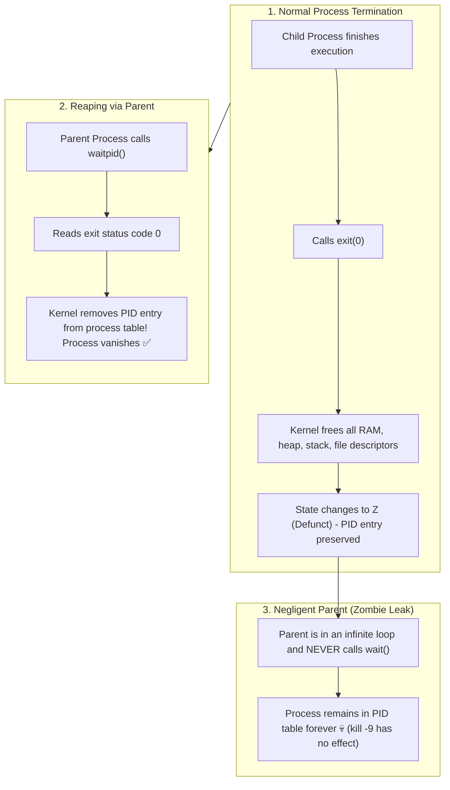

## 🎯 The Question

> **"You find a process in `ps aux` with status `Z` (Zombie / Defunct). You execute `kill -9 <PID>` as the root user. Nothing happens—the zombie process continues to exist! Why can't `SIGKILL` kill a zombie process, and how do you actually get rid of it?"**

---

## ⚡ 30-Second Elevator Pitch

The fundamental realization is that **a zombie process is ALREADY DEAD**:
* Its thread execution has stopped, its memory space (code, heap, stack) is completely deallocated, and its file descriptors are closed.
* It consumes **0% CPU and 0 bytes of RAM**.

**Why `kill -9` Fails**:
* The `kill` command works by delivering a **Signal (`SIGKILL`)** to a process.
* A signal can only be handled by an **active, executing process**. You cannot kill what is already dead!

**Why Does the Zombie Exist at All?**
When a child process terminates, the Linux kernel keeps a tiny **Process Table Entry** (containing its PID, termination timestamp, and exit status code) so the parent process can read how the child finished.
If the parent process fails to call **`wait()` or `waitpid()`**, the kernel cannot delete the PID entry. The process remains trapped in the zombie state!

---

## 🧠 Under-the-Hood: How a Zombie is Created and Reaped



---

## 🔬 How to Actually Eliminate a Zombie Process

Because you cannot signal the zombie, you have two options:

### 1. Signal the Parent Process
Instruct the parent to reap its children by sending a `SIGCHLD` signal:
```bash
kill -s SIGCHLD <Parent_PID>
```
If the parent has a signal handler registered, it will execute `waitpid()` and clean up the zombie.

### 2. Kill the Parent Process (Orphan Adoption)
If the parent is buggy or stuck, terminate the parent:
```bash
kill -9 <Parent_PID>
```
* When the parent dies, the zombie child becomes an **Orphan**.
* The Linux OS adoption process kicks in: the kernel re-parents the orphan to **`PID 1` (`systemd` / `init`)**.
* `systemd` is programmed to immediately and continuously call `wait()` on all adopted children, instantly clearing the zombie from the process table!

---

## 📌 Comparison Matrix: Zombie Process vs. Orphan Process

| Dimension | Zombie Process (`Z` state) | Orphan Process |
| :--- | :--- | :--- |
| **Is it Running?** | ❌ **No (Already terminated)** | ✅ **Yes (Actively executing code)** |
| **Resource Usage** | 0% CPU, 0 MB RAM (Only 1 PID entry) | Consumes normal CPU, RAM, and sockets |
| **Parent Status** | Parent is still alive, but neglecting child | Parent died or crashed before the child |
| **Danger to System** | **PID Exhaustion** (Can prevent spawning new tasks) | Unintended background resource consumption |
| **Operating System Action**| Waits indefinitely for parent `wait()` | Immediately adopted by `PID 1` (`systemd`) |

---

## 💡 What Interviewers Ask Next (Follow-Up Traps)

1. **"If zombie processes consume no memory, why are they dangerous?"**
   - *Answer*: They consume **Process IDs (PIDs)**. Linux has a finite maximum number of PIDs defined in `/proc/sys/kernel/pid_max` (typically 32,768). If a buggy application creates thousands of un-reaped zombies, the kernel runs out of PIDs. Once exhausted, the system cannot launch new processes (`fork: Cannot allocate memory`), effectively freezing the operating system.

2. **"How do you write a C program that automatically reaps children without blocking?"**
   - *Answer*: Set the `SIGCHLD` signal handler to `SIG_IGN` (Ignore):
     ```c
     signal(SIGCHLD, SIG_IGN);
     ```
     This tells the kernel: *"I don't care about my child's exit status. Clean up its PID table entry immediately upon exit."*

---

:::tip Placement & Interview Takeaway
**Interview Answer**: `kill -9` fails on zombie processes because they are already dead and signals can only be delivered to running processes. A zombie is simply a retained entry in the kernel's process table waiting for its parent to call `waitpid()`. To remove a zombie, send `SIGCHLD` to the parent or kill the parent so `init` (PID 1) adopts and reaps it.
:::

---

## 📺 Video Explanation

<YouTubeEmbed 
  id="AjrHb9aKiuw" 
  title="Why kill -9 CANNOT Kill a Zombie Process | CS Interview #76" 
/>
