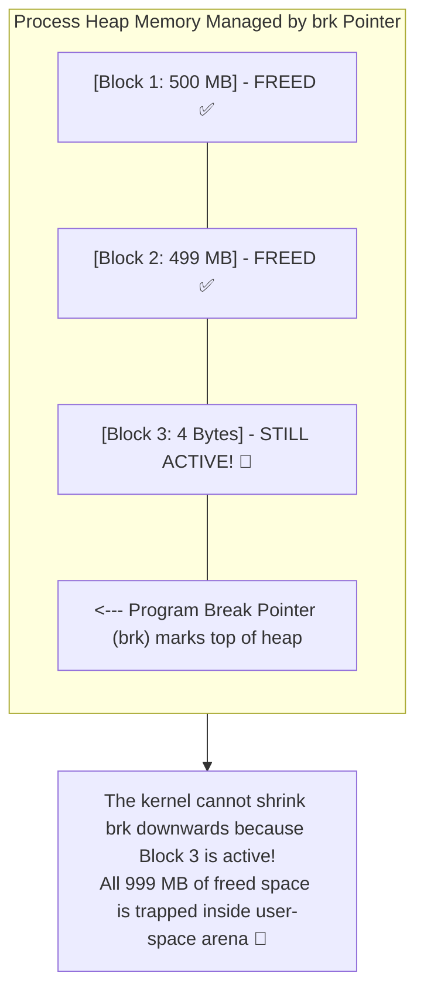

## 🎯 The Question

> **"You allocate 1 GB of heap memory in a C or C++ application (`malloc` / `new`). In Task Manager, your process memory usage spikes to 1 GB. Then, you call `free(ptr)`. Why does Task Manager STILL show 1 GB of RAM consumed, and why doesn't `free()` return memory to the operating system?"**

---

## ⚡ 30-Second Elevator Pitch

Developers assume `free()` is a system call that hands physical memory back to the Linux or Windows kernel. In reality, **`free()` is a purely user-space C runtime library function (glibc `ptmalloc`)**:

1. **System Call Overhead**: Calling the kernel (`brk` / `mmap`) on every single allocation would destroy performance (taking hundreds of CPU cycles for context switches).
2. **The Allocator Free List**: When you call `free(ptr)`, the allocator simply places that memory block into an **internal Free List (or Arena)**. The memory is marked "available for reuse" inside your process, but remains mapped to your process virtual address space.
3. **The Top-of-Heap Invariant**: The heap is managed by advancing the program break pointer (`brk`). Even if you free 999 MB at the bottom of the heap, if **a single 4-byte allocation exists at the top**, the kernel **cannot shrink the heap break pointer**, trapping all freed memory beneath it!

---

## 🧠 Under-the-Hood: The Heap Break Pointer (brk) Bottleneck

---

## 🔬 Small Allocations (`brk`) vs. Large Allocations (`mmap`)

The glibc memory allocator uses two different system calls depending on allocation size:

* **Small Allocations (ewer than 128 KB, controlled by `M_MMAP_THRESHOLD`)**:
  Allocated on the contiguous heap using **`brk()`**. Subject to top-of-heap pinning and external fragmentation. Memory is retained in the user-space free list upon `free()`.
* **Large Allocations (greater than 128 KB, e.g. 50 MB buffer)**:
  Bypasses the heap entirely and requests anonymous virtual memory pages directly from the OS using **`mmap()`**.
  When you call `free()` on an `mmap` allocation, glibc invokes **`munmap()`**, which **instantly unmaps the pages and releases RAM directly back to the operating system**!

---

## 📌 Comparison Matrix: Allocator Free List vs. OS Kernel Deallocation

| Metric | User-Space `free()` | Kernel `munmap()` / Heap Shrink |
| :--- | :--- | :--- |
| **Execution Layer** | User Space (glibc `ptmalloc` / jemalloc) | Kernel Space (Page Table teardown) |
| **System Call Issued?** | ❌ No (Zero context switch overhead) | ✅ Yes (`munmap` / `brk` syscall) |
| **Task Manager Effect** | Memory usage does NOT decrease | Memory usage decreases immediately |
| **Future Allocation** | ⚡ Instant reuse from local free list | Slower (Must request new OS frames) |
| **Memory Leak Risk** | High external fragmentation risk | Reclaimed cleanly |

---

## 💡 What Interviewers Ask Next (Follow-Up Traps)

1. **"What is `malloc_trim(0)` in Linux glibc?"**
   - *Answer*: `malloc_trim(0)` is an explicit glibc function that forces the memory allocator to release all free memory at the top of the heap back to the operating system by calling `brk()` to shrink the heap as far as possible. Database systems (like Redis) call this periodically to shed memory.

2. **"Why do production systems like Chrome, Meta, and Google replace glibc malloc with TCMalloc or Jemalloc?"**
   - *Answer*: **Jemalloc** and **TCMalloc** use thread-local caching, multiple arena pools, and aggressive memory purging to prevent fragmentation and multi-threaded lock contention, returning unneeded pages back to the OS via `madvise(MADV_DONTNEED)` much more efficiently than glibc.

---

:::tip Placement & Interview Takeaway
**Interview Answer**: `free()` does not return memory to the OS because it is a user-space library function that retains memory in an internal free list for future allocations to avoid system call overhead. Furthermore, memory allocated via `brk()` cannot be returned if active allocations exist at the top of the heap. Large allocations (> 128 KB) allocated via `mmap()` are returned immediately via `munmap()`.
:::

---

## 📺 Video Explanation

<YouTubeEmbed 
  id="8E8qy5fphr4" 
  title="Why free() NEVER Returns RAM to Your OS | CS Interview #77" 
/>
