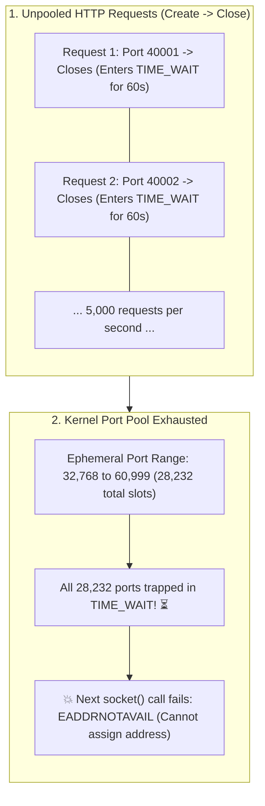

## 🎯 The Question

> **"You deploy a high-performance backend microservice making 5,000 HTTP requests per second to an external payment API. Under load, your service suddenly crashes with the error: `EADDRNOTAVAIL: Cannot assign requested address`. Why does closing TCP connections trigger this crash, and what is the TIME_WAIT state?"**

---

## ⚡ 30-Second Elevator Pitch

Every outgoing TCP connection is uniquely identified by a **4-Tuple**:
$$\{\text{Source IP}, \ \mathbf{Source\ Port}, \ \text{Destination IP}, \ \text{Destination\ Port}\}$$

When your service connects to an external API (`api.stripe.com:443`), three of those variables are fixed. The Linux kernel must assign an unused **Ephemeral Port** (by default, ports `32768` to `60999`, offering $\approx \mathbf{28{,}232\text{ ports}}$).

**The TIME_WAIT Trap**:
* Whichever side actively closes the TCP connection first **must stay in the `TIME_WAIT` state for $2 \times \text{MSL}$ (Maximum Segment Lifetime = 60 seconds)**.
* During these 60 seconds, **that local port number is permanently locked** by the kernel to ensure lingering packets from the old connection do not corrupt future connections.
* At 5,000 req/sec without connection pooling:
  $$5{,}000 \times 60\text{ seconds} = \mathbf{300{,}000\text{ ports needed}}$$
* The system exhausts all 28,000 ephemeral ports in **under 6 seconds**, throwing `Cannot assign requested address`!

---

## 🧠 Under-the-Hood: Ephemeral Port Exhaustion Pipeline



---

## 🔬 How to Fix: HTTP Keep-Alive & Connection Pooling

The primary production solution is to **stop creating and destroying TCP connections**:

### 1. Enable HTTP Keep-Alive & Connection Pooling
Reuse existing TCP connections across thousands of requests:
* **Node.js**: Use `http.Agent({ keepAlive: true, maxSockets: 500 })`.
* **Go**: `http.Client` with `Transport.MaxIdleConnsPerHost = 100`.
* **Python**: Use `requests.Session()` instead of raw `requests.get()`.

### 2. Linux Kernel Socket Reuse (`tcp_tw_reuse`)
Allow the kernel to safely recycle `TIME_WAIT` sockets for outgoing connections when timestamps match:
```bash
sysctl -w net.ipv4.tcp_tw_reuse=1
```

### 3. Expand Ephemeral Port Range
```bash
sysctl -w net.ipv4.ip_local_port_range="1024 65535"
```

---

## 📌 Comparison Matrix: Unpooled Requests vs. Connection Pooling

| Metric | Without Connection Pool (Short-Lived Sockets) | With HTTP Connection Pool (Persistent Keep-Alive) |
| :--- | :--- | :--- |
| **TCP Handshake Overhead** | 3-way handshake on **every single request** | Handshake done **once**; reused for thousands of requests |
| **TLS / SSL Handshake** | Expensive crypto negotiation on every call | 0 ms overhead after initial connection |
| **Ephemeral Port Churn** | Thousands of ports consumed per second | Uses a fixed pool of ~50 to 500 socket ports |
| **`TIME_WAIT` Accumulation**| Rapidly exhausts port limits (`EADDRNOTAVAIL`) | Near zero sockets in `TIME_WAIT` state |
| **API Latency** | 50–150 ms per request | **2–5 ms per request** ($20\times$ faster!) |

---

## 💡 What Interviewers Ask Next (Follow-Up Traps)

1. **"Why does TCP mandate the TIME_WAIT state in the first place?"**
   - *Answer*: Two critical reasons:
     1. **Reliable connection termination**: If the final `ACK` from the active closer is lost, the peer retransmits `FIN`. The closer must be in `TIME_WAIT` to resend `ACK`, rather than responding with `RST`.
     2. **Preventing packet corruption**: Lingering duplicate packets delayed in routers must completely die in the network before a new connection reuses the same 4-tuple.

2. **"Why was `net.ipv4.tcp_tw_recycle` removed from recent Linux kernels?"**
   - *Answer*: `tcp_tw_recycle` aggressively recycled sockets based on per-host timestamps. When clients sat behind a NAT gateway (like mobile carriers or corporate firewalls), multiple devices shared one public IP with unsynchronized clock timestamps, causing legitimate connections to be dropped randomly. It was removed in Linux 4.12.

---

:::tip Placement & Interview Takeaway
**Interview Answer**: `Cannot assign requested address` happens when a client exhausts its ephemeral port pool because closed TCP connections stay locked in the 60-second `TIME_WAIT` state. To fix this in production, never open raw HTTP connections per request; always use HTTP Keep-Alive connection pools to reuse established TCP sockets.
:::

---

## 📺 Video Explanation

<YouTubeEmbed 
  id="fq0ESYj_yB4" 
  title="Why Fast APIs Crash with Cannot Assign Address | CS Interview #78" 
/>
