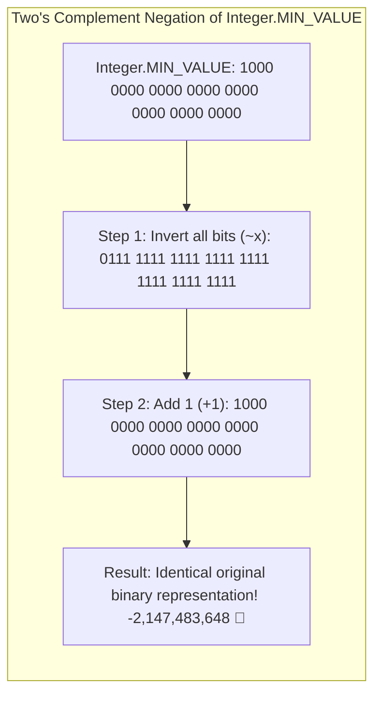

## 🎯 The Question

> **"In Java, C++, and C#, what does `Math.abs(Integer.MIN_VALUE)` return? Why does a mathematical absolute value function return a negative number (`-2,147,483,648`), and how can this crash hash-based sharding algorithms?"**

---

## ⚡ 30-Second Elevator Pitch

Modern computer architectures represent signed integers using **Two's Complement notation**.

In a 32-bit signed integer (`int`):
* The range is strictly **Asymmetric**:
  $$[-2^{31}, \ 2^{31} - 1] \implies [\mathbf{-2{,}147{,}483{,}648}, \ \mathbf{+2{,}147{,}483{,}647}]$$
* Notice that the negative spectrum has **one more number** than the positive spectrum because `0` occupies one of the positive binary states!

When you compute the absolute value of $\text{Integer.MIN\_VALUE} = -2{,}147{,}483{,}648$:
* The true mathematical answer is $+2{,}147{,}483{,}648$.
* But the maximum positive value a 32-bit integer can store is only $+2{,}147{,}483{,}647$!
* Negating `-2,147,483,648` overflows the 32-bit boundary, producing **`-2,147,483,648`**.

---

## 🧠 Under-the-Hood: Two's Complement Inversion Math



The hardware simply inverts the bits and adds 1. For `Integer.MIN_VALUE`, this arithmetic operation results in the exact same binary pattern with the sign bit set to 1!

---

## 🔬 How This Crashes Hash Sharding in Production

Developers frequently use `Math.abs()` to map hash codes to positive array or database shard indices:

```java
// ❌ PRODUCTION BUG: Crashes on Integer.MIN_VALUE!
int shardId = Math.abs(key.hashCode()) % numShards;
// If key.hashCode() == Integer.MIN_VALUE:
// Math.abs(...) returns -2147483648!
// -2147483648 % 10 = -8 -> Array/Shard Index Out of Bounds! 💥
```

### Production Fixes
1. **Bitwise Masking (Eliminates Sign Bit)**:
   ```java
   int shardId = (key.hashCode() & 0x7FFFFFFF) % numShards; // Guaranteed positive!
   ```
2. **Java 15+ Math.absExact()**:
   Throws an explicit `ArithmeticException` on overflow rather than silently propagating corrupt negative values.
3. **Promote to 64-bit Long**:
   ```java
   long safeVal = Math.abs((long) val);
   ```

---

## 📌 Comparison Matrix: Integer Bounds and Two's Complement

| Metric | Minimum Value | Maximum Value | Total Distinct Values |
| :--- | :--- | :--- | :--- |
| **8-Bit Signed (`byte`)** | $-128$ | $+127$ | 256 |
| **16-Bit Signed (`short`)**| $-32{,}768$ | $+32{,}767$ | 65,536 |
| **32-Bit Signed (`int`)** | **$-2{,}147{,}483{,}648$** | **$+2{,}147{,}483{,}647$** | $4{,}294{,}967{,}296$ |
| **64-Bit Signed (`long`)**| $-2^{63}$ | $2^{63} - 1$ | $2^{64}$ |

---

## 💡 What Interviewers Ask Next (Follow-Up Traps)

1. **"Why does Java's `%` operator return negative numbers?"**
   - *Answer*: In Java and C++, `%` is the **remainder operator**, not the mathematical modulo operator. It preserves the sign of the dividend: `-7 % 3 = -1`. To get a true mathematical positive modulo, use `Math.floorMod(a, b)`:
     ```java
     Math.floorMod(-7, 3); // Returns 2!
     ```

2. **"What happens if you execute `Integer.MIN_VALUE / -1`?"**
   - *Answer*: It overflows and returns `Integer.MIN_VALUE` (`-2,147,483,648`)! In C++, signed integer overflow is undefined behavior (UB); in Java, it wraps silently without an exception.

---

:::tip Placement & Interview Takeaway
**Interview Answer**: `Math.abs(Integer.MIN_VALUE)` returns a negative number because Two's Complement integer representations are asymmetric (ranging from $-2^{31}$ to $2^{31}-1$). The positive counterpart $+2,147,483,648$ cannot fit in a 32-bit signed integer, overflowing back to $-2,147,483,648$. Never use `Math.abs()` for shard indexing; use bitmasking (`hash & 0x7FFFFFFF`).
:::

---

## 📺 Video Explanation

<YouTubeEmbed 
  id="qlP6Ah8FKqU" 
  title="Why Math.abs() Returns a NEGATIVE Number | CS Interview #79" 
/>
