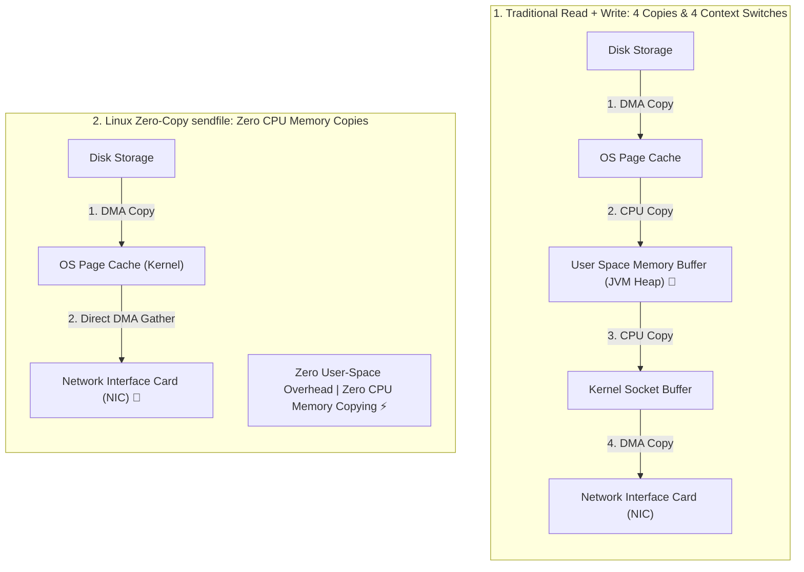

## 🎯 The Question

> **"Apache Kafka can stream gigabytes of data per second across thousands of consumer connections while maintaining near 0% CPU utilization. How does Kafka bypass the CPU using Linux Zero-Copy (`sendfile`), and why is traditional file reading so slow?"**

---

## ⚡ 30-Second Elevator Pitch

Traditional file transfer across a network (e.g. standard file server) requires **4 Context Switches and 4 Data Copies**:
1. `read()`: CPU switches to kernel mode. DMA copies data from disk to OS **Page Cache**.
2. CPU copies data from Page Cache into **User-Space Application Memory Buffer**. Context switches back to user mode.
3. `write()`: CPU switches to kernel mode, copying data from user buffer into **Kernel Socket Buffer**.
4. DMA copies data from socket buffer to the **Network Interface Card (NIC)**.

**Kafka's Secret: Linux Zero-Copy (`sendfile` / `transferTo`)**:
Kafka calls `sendfile()`, telling the kernel: *"Take data from this file descriptor and pipe it directly to this socket descriptor."*
* The data **never crosses into user space**.
* With modern Scatter-Gather DMA, data travels **directly from the OS Page Cache to the Network Card**.
* The CPU never copies a single byte; it acts only as an orchestrator, dropping CPU utilization to near **0%**!

---

## 🧠 Under-the-Hood: Traditional 4-Copy vs. Linux Zero-Copy



---

## 🔬 Java NIO: `FileChannel.transferTo()`

In Kafka's Scala/Java broker codebase, message dispatch boils down to a single Java NIO call:

```java
public void transferTo(FileChannel fileChannel, SocketChannel socketChannel, long position, long count) {
    // Maps directly to the underlying Linux sendfile() system call
    fileChannel.transferTo(position, count, socketChannel);
}
```

Because Kafka does not modify the message payload (messages are already serialized and compressed by the producer), the broker acts as a pure passthrough pipeline.

---

## 📌 Comparison Matrix: Traditional I/O vs. Zero-Copy `sendfile()`

| Dimension | Standard `read()` + `write()` | Linux `sendfile()` (Zero-Copy) |
| :--- | :--- | :--- |
| **Context Switches** | 4 (User $\to$ Kernel $\to$ User $\to$ Kernel $\to$ User) | **2** (User $\to$ Kernel $\to$ User) |
| **Data Memory Copies** | 4 (2 DMA + 2 CPU copies) | **2 DMA copies, 0 CPU copies** |
| **User-Space RAM Usage**| Allocates JVM heap buffers (Triggers GC) | **0 bytes** of application memory |
| **CPU Utilization** | High (CPU spent copying memory bytes) | **Near 0%** (CPU idle while DMA streams) |
| **Cache Pollution** | Pollutes L1/L2/L3 hardware caches | Leaves CPU hardware caches cold and clean |

---

## 💡 What Interviewers Ask Next (Follow-Up Traps)

1. **"Can Kafka use Zero-Copy if TLS/SSL encryption is enabled?"**
   - *Answer*: **No (traditionally).** To encrypt data with TLS, the CPU must read plaintext bytes, run AES encryption, and write encrypted bytes to the socket buffer. This forces data into user space, breaking standard `sendfile()`. However, modern Linux kernels (4.13+) support **Kernel TLS (kTLS)**, allowing hardware network cards or the kernel to encrypt directly during DMA transmission!

2. **"Why does Kafka rely on the OS Page Cache instead of JVM in-memory caching?"**
   - *Answer*: If Kafka cached 30 GB of messages in JVM heap memory, Java Garbage Collection would suffer catastrophic multi-second stop-the-world pauses. By relying on the **Linux OS Page Cache**, memory is managed outside the JVM without GC overhead, and pages remain cached even if the Kafka broker process restarts!

---

:::tip Placement & Interview Takeaway
**Interview Answer**: Kafka achieves ultra-high throughput with near 0% CPU usage by using the Linux `sendfile()` system call (Zero-Copy). Instead of copying data from kernel to user space and back to socket buffers, `sendfile()` uses Scatter-Gather DMA to stream bytes directly from the OS Page Cache to the Network Card, eliminating CPU copying overhead and GC pressure.
:::

---

## 📺 Video Explanation

<YouTubeEmbed 
  id="ZcyvyA8KqHM" 
  title="How Kafka Streams at 0% CPU (Linux Zero-Copy) | CS Interview #81" 
/>
