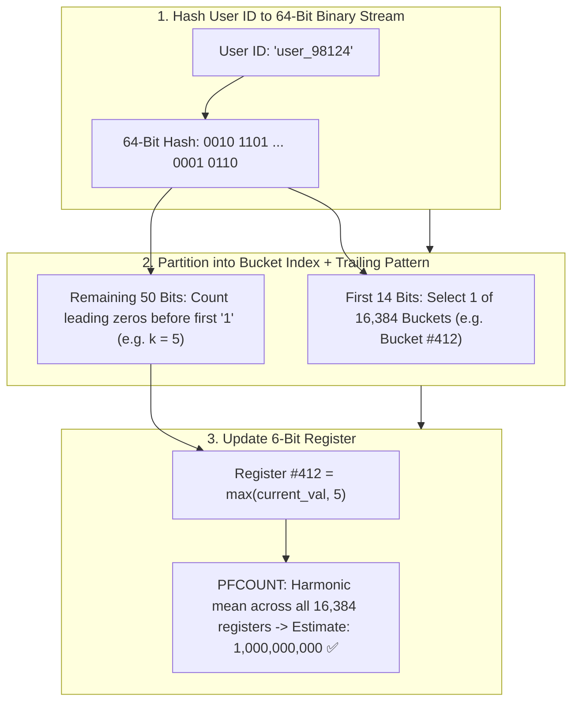

## 🎯 The Question

> **"You need to count the number of Unique Active Users (Cardinality) visiting a website daily. If you store 1 billion 64-bit user IDs in a standard Hash Set, it consumes over 12 GB of RAM. How does Redis's `PFADD` / `PFCOUNT` (HyperLogLog) count 1 billion unique users with 99% accuracy using only 12 KB of memory?"**

---

## ⚡ 30-Second Elevator Pitch

To count unique items exactly, you must store every single item (Linear $O(N)$ memory).

**HyperLogLog (HLL)** is a **Probabilistic Cardinality Estimation Algorithm**:
* It doesn't remember *which* users visited; it estimates *how many* unique users visited.
* **The Coin Toss Analogy**: If you flip a fair coin repeatedly, the probability of getting 10 heads in a row ($H^{10}$) is $\frac{1}{2^{10}} = \frac{1}{1024}$. If someone tells you their longest streak of consecutive heads is 10, you can estimate they probably flipped the coin around 1,000 times!

**How Redis Implements HyperLogLog**:
1. Hashes user IDs into a uniform 64-bit binary sequence.
2. Observes the **maximum number of leading zeros** in the binary hash.
3. To eliminate variance, Redis divides the stream into **16,384 independent buckets (registers)** and computes the **Harmonic Mean**.
4. Each register stores up to 6 bits:
   $$16{,}384 \text{ registers} \times 6\text{ bits} = 98{,}304\text{ bits} = \mathbf{12\text{ KB of RAM}}$$

Regardless of whether you add 1,000 items or 10 billion items, **memory usage is capped at exactly 12 KB** with a standard error rate of only **$0.81\%$**!

---

## 🧠 Under-the-Hood: Hashing, Bucketing, and Leading Zeros

---

## 🔬 Mathematical Estimation Formula

The cardinality estimate $E$ across $m$ registers is:

$$E = \alpha_m \cdot m^2 \cdot \left( \sum_{j=1}^m 2^{-M[j]} \right)^{-1}$$

Where:
* $m = 16{,}384$ registers.
* $M[j]$ is the maximum leading zero count stored in register $j$.
* $\alpha_m = 0.7213 / (1 + 1.079/m)$ is a bias correction constant.
* The standard error is:
  $$\text{Standard Error} = \frac{1.04}{\sqrt{m}} = \frac{1.04}{\sqrt{16384}} \approx \mathbf{0.81\%}$$

For an estimated 100,000,000 unique users, an error of $0.81\%$ means your count will be between 99.19M and 100.81M—an acceptable trade-off to save 12 GB of RAM!

---

## 📌 Comparison Matrix: Hash Set vs. Bitmap vs. HyperLogLog

| Data Structure | Memory for 100M Users | Memory for 1 Billion Users | Accuracy | Can Retrieve IDs? |
| :--- | :--- | :--- | :---: | :---: |
| **Hash Set (`Set<Long>`)** | ~1.2 GB | **~12 GB to 24 GB** | 100% Exact | ✅ Yes |
| **Bitmap (`SETBIT`)** | ~12.5 MB | **~125 MB** | 100% Exact | ❌ No (Integer IDs only) |
| **HyperLogLog (`PFADD`)** | **12 KB** | **12 KB (Constant!)** | $\approx 99.2\%$ ($\pm 0.81\%$) | ❌ No |

---

## 💡 What Interviewers Ask Next (Follow-Up Traps)

1. **"Can you merge HyperLogLogs across multiple days or servers?"**
   - *Answer*: **Yes!** HyperLogLog supports lossless union via the `PFMERGE` command. Because registers only store the maximum leading zero count, merging two sets takes the element-wise maximum: `merged[i] = max(hll1[i], hll2[i])`. This makes it trivial to calculate Weekly or Monthly Unique Active Users without storing raw data!

2. **"Why does Redis start HyperLogLog in 'Sparse' representation before 12 KB?"**
   - *Answer*: If a key only has a few dozen unique visitors, allocating 12 KB is wasteful. Redis starts in a **Sparse Representation** using run-length encoding (consuming as little as a few hundred bytes). Once the cardinality grows, Redis automatically converts it to the standard 12 KB **Dense Representation**.

---

:::tip Placement & Interview Takeaway
**Interview Answer**: Redis counts 1 billion unique users in 12 KB using HyperLogLog, a probabilistic cardinality estimation algorithm. It hashes elements and records the maximum consecutive leading zeros across 16,384 registers. Using the harmonic mean of these registers, it estimates cardinality with a $0.81\%$ error margin in constant 12 KB memory.
:::

---

## 📺 Video Explanation

<YouTubeEmbed 
  id="Iv-xTV4GlcA" 
  title="How Redis Counts 1 Billion Users in 12 KB RAM | CS Interview #82" 
/>
