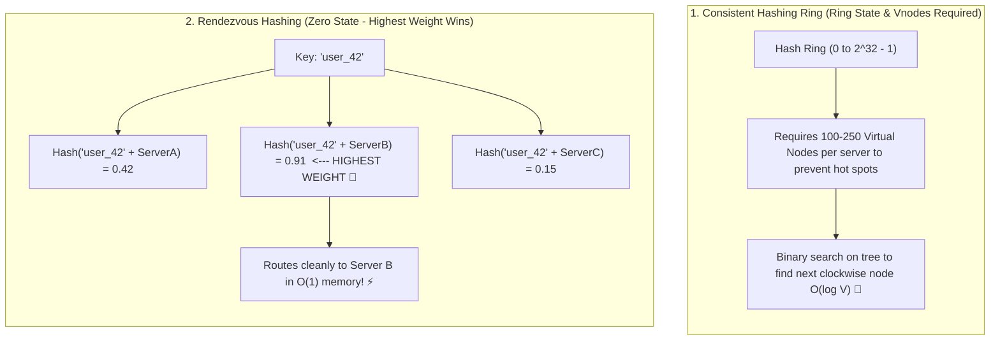

## 🎯 The Question

> **"In distributed caching and load balancing interviews, Consistent Hashing is taught as the default solution. Why do large distributed systems (like Google, Apple, and Microsoft's CARP proxy) often prefer Rendezvous Hashing (Highest Random Weight) over a Consistent Hashing ring?"**

---

## ⚡ 30-Second Elevator Pitch

While **Consistent Hashing** is conceptually popular, maintaining a hash ring in production has hidden architectural drawbacks:
1. It requires **Virtual Nodes (vnodes)** (often 100–250 vnodes per physical server) to balance load evenly, bloating memory tables.
2. Routing a key requires a binary search lookup ($O(\log(\text{nodes} \times \text{vnodes}))$) across an ordered tree.
3. Every client must maintain a synchronized copy of the exact ring topology.

**Rendezvous Hashing (Highest Random Weight / HRW)** eliminates the ring entirely:
* To route a key $K$, you compute a independent hash score for **every candidate server**:
  $$\text{Score}(K, S_i) = \text{Hash}(K + S_i)$$
* You route the request to the server that yields the **Highest Score (Maximum Weight)**:
  $$S^* = \arg\max_{S_i} \text{Hash}(K + S_i)$$

**The Production Advantage**:
* **Zero Ring Maintenance**: No ring structures, no virtual nodes, and zero memory overhead.
* **Uniform Key Distribution**: Hashes distribute uniformly without cluster tuning.
* **Graceful Failure Rebalancing**: If the top server fails, the key naturally and deterministically falls to the second-highest score server with zero re-hashing cascade!

---

## 🧠 Under-the-Hood: Consistent Hashing Ring vs. Rendezvous Highest Score

---

## 🔬 Failure Handling: Natural Fallback Without Cascade

What happens if Server B crashes?
* Under Rendezvous Hashing, you simply re-evaluate the scores across remaining servers $\{A, C\}$.
* Since Server A scored $0.42$ and Server C scored $0.15$, **Server A automatically becomes the new highest winner**.
* Keys originally assigned to Server A and Server C are **completely undisturbed**! Only keys that belonged to failed Server B are evenly distributed among remaining healthy nodes.

---

## 📌 Comparison Matrix: Consistent Hashing vs. Rendezvous Hashing

| Dimension | Consistent Hashing Ring | Rendezvous Hashing (HRW) |
| :--- | :--- | :--- |
| **Data Structure Needed** | Ordered Red-Black Tree / Ring | **None (Pure stateless function)** |
| **Memory Footprint** | $O(N \times V)$ where $V = 100\text{–}250$ vnodes | **$O(1)$ Zero memory** |
| **Routing Time Complexity**| $O(\log(N \times V))$ binary search | $O(N)$ hash evaluations (where $N$ is server count) |
| **Load Uniformity** | Can be lumpy unless tuned with high vnodes | **Perfect statistical uniformity out of the box** |
| **Use Cases** | DynamoDB, Cassandra, Akamai | Apple iCloud, Microsoft CARP proxy, Google internal RPCs |

---

## 💡 What Interviewers Ask Next (Follow-Up Traps)

1. **"Isn't evaluating $O(N)$ hashes per key too slow if you have 10,000 servers?"**
   - *Answer*: If $N$ is thousands of nodes, evaluating $N$ hashes per request adds CPU overhead. Production architectures use **Hierarchical Rendezvous Hashing** (e.g. cluster level first, then rack level, then node level), reducing complexity to $O(\log N)$ while maintaining the zero-state advantage!

2. **"Can Rendezvous Hashing support heterogeneous servers with different capacities?"**
   - *Answer*: **Yes!** Multiply the hash output by an exponential weight factor:
     $$\text{Score}(K, S_i) = -\frac{w_i}{\ln(\text{Hash}(K + S_i))}$$
     A server with weight $w_i = 2$ receives twice as many requests as a server with $w_i = 1$, enabling seamless weighted capacity routing.

---

:::tip Placement & Interview Takeaway
**Interview Answer**: Rendezvous Hashing (Highest Random Weight) hashes the key with each candidate server name and picks the highest scoring node. Unlike Consistent Hashing, it eliminates virtual nodes, requires zero ring memory, achieves uniform distribution, and naturally fails over to the next highest-scoring node without cascade.
:::

---

## 📺 Video Explanation

<YouTubeEmbed 
  id="s8x3RWLLxlk" 
  title="Why Large Systems Prefer Rendezvous Hashing | CS Interview #83" 
/>
