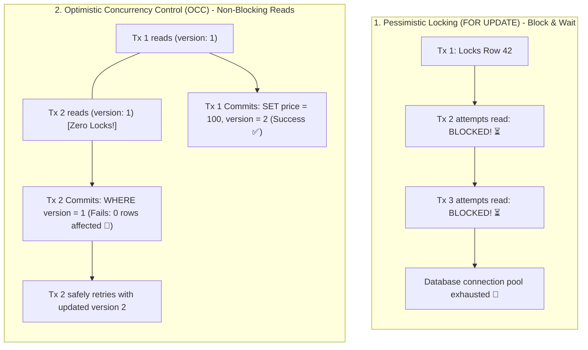

## 🎯 The Question

> **"When multiple users read and update database records concurrently, why does Pessimistic Locking (`SELECT ... FOR UPDATE`) destroy throughput in web applications? How does Optimistic Concurrency Control (OCC) eliminate lock contention using a simple `version` column?"**

---

## ⚡ 30-Second Elevator Pitch

Concurrency management in databases follows two philosophies:

* **Pessimistic Locking (Assume the Worst)**:
  Assumes collisions are frequent. Every transaction acquires an **exclusive row lock (`FOR UPDATE`)** upfront. Other transactions must block and wait.
  * *The Trap*: If a user pauses to review checkout details, or network latency delays a request, the database row remains locked. Connection pools exhaust, threads starve, and transactions deadlock.
* **Optimistic Concurrency Control (Assume Conflicts are Rare)**:
  Assumes collisions are infrequent (true for 95% of web apps).
  * Transactions **never acquire locks during reads**.
  * Each record has a `version` column (e.g. `version = 1`).
  * At commit time, the update checks whether the version is still unchanged:
    ```sql
    UPDATE products 
    SET price = 100, version = version + 1 
    WHERE id = 42 AND version = 1;
    ```
  * If another transaction updated the row first, the version is now `2`. The update affects `0 rows`, and the application safely retries or notifies the user!

---

## 🧠 Under-the-Hood: Pessimistic Lock Queuing vs. Non-Blocking OCC



---

## 🔬 Code Walkthrough: Implementing OCC in Production

```python
def update_product_price(product_id, new_price, max_retries=3):
    for attempt in range(max_retries):
        # 1. Read without ANY locks
        product = db.query("SELECT price, version FROM products WHERE id = :id", id=product_id)
        
        # 2. Attempt atomic update with version check
        rows_updated = db.execute(
            "UPDATE products SET price = :price, version = version + 1 "
            "WHERE id = :id AND version = :current_version",
            price=new_price, id=product_id, current_version=product.version
        )
        
        # 3. Check if conflict occurred
        if rows_updated == 1:
            return "Updated successfully!"
        
        # Conflict detected: another user modified the row! Retry loop...
    raise ConflictError("Concurrent modification detected. Please try again.")
```

---

## 📌 Comparison Matrix: Pessimistic Locking vs. OCC

| Dimension | Pessimistic Locking (`FOR UPDATE`) | Optimistic Concurrency Control (OCC) |
| :--- | :--- | :--- |
| **Lock Acquisition** | Exclusive X-lock acquired on `SELECT` | **Zero locks** acquired during read |
| **Read Throughput** | Restricted (Readers queue behind writers) | ⚡ **Maximum** (All readers proceed concurrently) |
| **Deadlock Risk** | High (Multi-row locks can circular wait) | **Zero deadlock risk** |
| **Network Latency Impact**| Holds locks across external network calls | Completely immune to user think-time latency |
| **Best Used When** | High contention / heavy write collisions | **Low to medium contention** (Standard web APIs) |

---

## 💡 What Interviewers Ask Next (Follow-Up Traps)

1. **"When does Optimistic Concurrency Control FAIL and perform worse than locks?"**
   - *Answer*: Under **Extreme Write Contention** (e.g. 10,000 users attempting to buy 1 concert ticket at the exact same second). In OCC, 1 user succeeds and 9,999 transactions fail and retry simultaneously, creating a **Retry Storm** that overwhelms the database with redundant queries. Under extreme write contention, queueing with Redis or pessimistic locks is superior.

2. **"Can we use timestamps (`updated_at`) instead of an integer `version` for OCC?"**
   - *Answer*: Timestamps are risky because clock resolution on some operating systems or database engines can be coarse (milliseconds), allowing two concurrent updates in the same millisecond to share the exact same timestamp. An **auto-incrementing integer version** is 100% immune to clock drift and precision limits.

---

:::tip Placement & Interview Takeaway
**Interview Answer**: Pessimistic locking acquires exclusive locks on read, introducing connection starvation and deadlocks. Optimistic Concurrency Control uses a `version` column, allowing concurrent non-blocking reads and checking `WHERE version = current_version` upon write. If a collision occurs, zero rows are affected, allowing safe application retries.
:::

---

## 📺 Video Explanation

<YouTubeEmbed 
  id="gU7pjHRsC5I" 
  title="Why Optimistic Concurrency Control Beats Locks | CS Interview #84" 
/>
