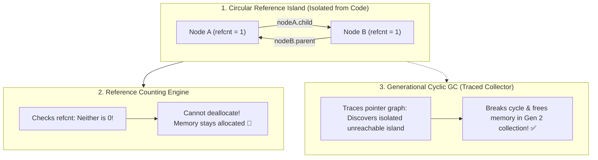

## 🎯 The Question

> **"Developers often assume Python is completely immune to memory leaks because it has automatic garbage collection. How can a Python application leak gigabytes of RAM without throwing an error, and why do circular references defeat Reference Counting?"**

---

## ⚡ 30-Second Elevator Pitch

Python's primary memory management mechanism is **Reference Counting**:
* Every Python object has an internal field: `ob_refcnt`.
* When an object is referenced (`b = a`), `ob_refcnt` increments.
* When a reference goes out of scope (`del b`), `ob_refcnt` decrements.
* The moment an object's reference count drops to **0**, Python **instantly deallocates its memory**.

**The Trap: Circular References**:
```python
class Node:
    pass

nodeA = Node()
nodeB = Node()
nodeA.child = nodeB
nodeB.parent = nodeA # Circular reference!

del nodeA # Decrements ref count from 2 to 1
del nodeB # Decrements ref count from 2 to 1
```
Neither object can ever be accessed by your program again. But because they point to each other, **both reference counts remain at 1!** Reference counting can never free them!

---

## 🧠 Under-the-Hood: Circular References and Python's Generational GC



---

## 🔬 Why Python Still Leaks: The `__del__` Method Trap

To clean up circular references, Python runs a secondary **Generational Cyclic Garbage Collector** (Generations 0, 1, and 2).

However, memory leaks still occur in production due to two major causes:

### 1. Custom `__del__` Finalizers in Cycles (Legacy Python / Complex Objects)
If objects in a circular reference define a custom `__del__()` destructor:
* Python doesn't know which object's `__del__` should run first.
* Running A's destructor might fail if it relies on B, and vice versa.
* In older Python versions (pre-3.4 PEP 442), Python gives up and places the objects into `gc.garbage` (**uncollectable garbage**), leaking them forever in RAM!

### 2. Module-Level Global Collections
Appending items to global lists, class-level caches, or un-evicted dictionaries:
```python
cache = {} # Global cache that never evicts keys -> Permanent memory leak!
```

---

## 📌 Comparison Matrix: Reference Counting vs. Generational GC

| Dimension | Reference Counting (Primary) | Generational Tracing GC (Secondary) |
| :--- | :--- | :--- |
| **Execution Trigger** | Real-time on every `del` or variable scope exit | Periodic (When allocation thresholds exceed thresholds) |
| **Latency** | ⚡ Instantaneous deallocation ($0\text{ ms}$) | Pauses execution (Triggers GC CPU spikes) |
| **CPU Overhead** | Small cost on every pointer assignment | Graph traversal cost over thousands of heap objects |
| **Circular Reference Support**| ❌ **Completely blind to cycles** | ✅ Finds and resolves isolated cyclic islands |
| **Can Be Disabled?** | No (Core CPython runtime foundation) | Yes (`gc.disable()`, used by Instagram to speed up workers) |

---

## 💡 What Interviewers Ask Next (Follow-Up Traps)

1. **"How do you break circular references without relying on the cyclic GC?"**
   - *Answer*: Use Python's **`weakref` module** (`weakref.ref` or `weakref.proxy`). A weak reference allows you to access a target object without incrementing its `ob_refcnt`. When the only remaining references to an object are weak references, it is freed immediately.

2. **"Why did Instagram famously disable Python's Generational GC in production?"**
   - *Answer*: In multi-worker Django deployments using `fork()`, the Generational GC mutates object headers (`gc_refs`) during graph traversals. This dirtied physical memory pages, destroying **Linux Copy-on-Write (CoW)** efficiency and causing each child process to duplicate 100+ MB of RAM. Disabling `gc.disable()` saved them 10% memory across thousands of servers!

---

:::tip Placement & Interview Takeaway
**Interview Answer**: Python uses Reference Counting for immediate memory deallocation, but reference counting fails on circular references because ref counts never reach zero. While Python's secondary Generational Cyclic GC can detect and clean these cycles, leaks occur if cyclical objects have conflicting `__del__` destructors or grow unbounded in global caches. Use `weakref` to prevent cycles.
:::

---

## 📺 Video Explanation

<YouTubeEmbed 
  id="MntGsBeNyQg" 
  title="Why Python Leaks Memory | CS Interview #85" 
/>
