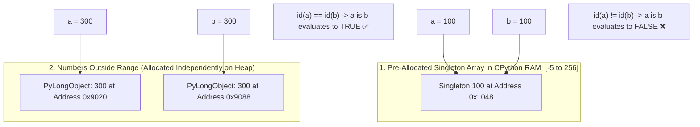

## 🎯 The Question

> **"In Python's interactive terminal, type `a = 100; b = 100; a is b` $\to$ Returns `True`. Then type `a = 300; b = 300; a is b` $\to$ Returns `False`! Why does Python behave differently for 100 and 300, and what is the difference between `is` and `==`?"**

---

## ⚡ 30-Second Elevator Pitch

The discrepancy occurs because of **CPython's Small Integer Caching (Integer Interning)**:

1. In Python, **everything is an object on the heap**, including numbers. Allocating a brand new 28-byte `PyLongObject` for every single loop counter and index calculation would be catastrophically slow.
2. During interpreter startup, CPython pre-allocates an internal array of singleton integer objects for the range:
   $$[-5, \ 256]$$
3. Whenever you assign a variable to a number in this range (like `100`), Python **does not create a new object**—it points your variable directly to the pre-existing singleton in memory.
4. For numbers outside this range (like `300`), Python allocates a **new, distinct heap object** every time.
5. **The `is` Operator Trap**:
   - `==` checks **Value Equality** (`a.__eq__(b)`: Does 300 equal 300? $\to$ `True`).
   - `is` checks **Memory Address Identity** (`id(a) == id(b)`: Are they the exact same physical heap object? $\to$ `False`).

---

## 🧠 Under-the-Hood: CPython Small Integer Singleton Array

---

## 🔬 Why Does the Range Start at -5 and End at 256?

Guido van Rossum and the Python core team profiled millions of lines of real-world Python code:
* Negative numbers smaller than `-5` are rarely used.
* The numbers `-5` through `256` cover:
  - Common return codes (`-1`, `0`, `1`)
  - Loop iterators and indices
  - All 256 ASCII / byte values ($0\text{ to }255$)
* Caching this array takes negligible memory (~7 KB), but speeds up execution and avoids millions of heap allocations.

---

## 📌 Comparison Matrix: `==` (Equality) vs. `is` (Identity)

| Aspect | `==` (Value Equality) | `is` (Reference / Identity Equality) |
| :--- | :--- | :--- |
| **What it Compares** | Underlying data values | Physical memory addresses (`id(a) == id(b)`) |
| **Underlying Method** | Calls `a.__eq__(b)` | Pointer comparison in C: `a == b` |
| **Can Be Overridden?**| ✅ Yes (Custom classes override `__eq__`) | ❌ No (Hardcoded silicon pointer comparison) |
| **Correct Use Case** | Comparing numbers, strings, lists | **Checking singletons only (`val is None`, `val is True`)** |
| **`300 == 300`** | ✅ `True` | ❌ `False` |

---

## 💡 What Interviewers Ask Next (Follow-Up Traps)

1. **"Why does `a = 300; b = 300; a is b` return `True` when run inside a `.py` file or script?"**
   - *Answer*: This is the **Code Block Optimization Trap**! In the interactive REPL, each line is compiled independently. But when Python compiles an entire script or function at once, the **Constant Folding Compiler** notices identical immutable literals in the same code block and reuses the exact same constant object from the code object's `co_consts` tuple.

2. **"Does Python intern strings as well?"**
   - *Answer*: **Yes!** Python automatically interns strings that look like Python identifiers (alphanumeric characters and underscores). You can also manually force string interning in performance-critical code using `sys.intern(string)` to enable blazing-fast pointer comparison.

---

:::tip Placement & Interview Takeaway
**Interview Answer**: `a is b` checks memory address identity, not value equality. CPython pre-allocates small integers from $-5$ to $256$ as shared singletons in memory, meaning variables assigned to 100 point to the same object. Numbers outside this range (like 300) are allocated as separate heap objects with different addresses. Always use `==` for numbers and reserve `is` for `None`.
:::

---

## 📺 Video Explanation

<YouTubeEmbed 
  id="s0TXhr9zK-w" 
  title="Why 100 is 100 is True, but 300 is 300 is False in Python | CS Interview #86" 
/>
