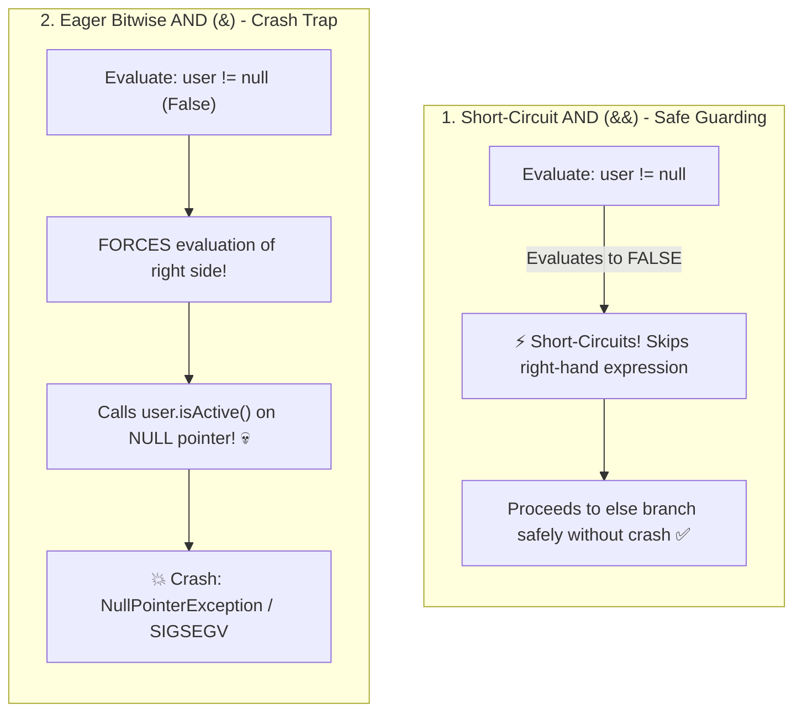

## 🎯 The Question

> **"In Java, C++, and JavaScript, why does `if (user != null && user.isActive())` execute safely without errors, while accidentally typing a single ampersand `if (user != null & user.isActive())` immediately crashes your application with a `NullPointerException`?"**

---

## ⚡ 30-Second Elevator Pitch

The difference between `&&` and `&` is **Short-Circuit Evaluation**:

* **Logical AND (`&&`) is Short-Circuited**:
  In Boolean logic, if the left condition is `false`, the overall expression can **never be true** ($\text{False} \land X \equiv \text{False}$).
  The compiler generates a conditional jump instruction that **completely skips evaluating the right-hand side**.
  If `user` is `null`, `user != null` evaluates to `false`, and `user.isActive()` is never executed!
* **Bitwise / Non-Short-Circuit AND (`&`)**:
  When applied to booleans, `&` is a non-short-circuiting logical operator.
  It mandates that **both the left and right expressions MUST be fully evaluated** before performing the bitwise AND.
  Even though `user != null` is `false`, the CPU still proceeds to call `user.isActive()` on a `null` reference—instantly crashing the application!

---

## 🧠 Under-the-Hood: Short-Circuit Branching vs. Eager Evaluation



---

## 🔬 Common Short-Circuit Guard Patterns

Short-circuit evaluation is the foundational mechanism for safe programming:

### 1. Null Guard Protection
```java
if (str != null && str.length() > 0) { ... } // Safe
```

### 2. Division-by-Zero Guard
```cpp
if (count != 0 && (total / count) > threshold) { ... } // Safe
```

### 3. Array Index Bounds Guard
```javascript
if (index >= 0 && index < arr.length && arr[index] === target) { ... } // Safe
```

In every case, replacing `&&` with `&` removes the guard, allowing the dangerous second operation to execute.

---

## 📌 Comparison Matrix: Logical `&&` / `||` vs. Bitwise `&` / `|`

| Operator Pair | Short-Circuiting? | What it Evaluates | Primary Purpose |
| :--- | :---: | :--- | :--- |
| **`&&` (Logical AND)** | ✅ **Yes** | Aborts immediately if left is **`false`** | Boolean conditions & safety guards |
| **`&` (Bitwise AND)** | ❌ **No** | **Always evaluates both sides** | Bitmasking binary integers (`x & 0xFF`) |
| **`\|\|` (Logical OR)** | ✅ **Yes** | Aborts immediately if left is **`true`** | Default fallbacks & alternative conditions |
| **`\|` (Bitwise OR)** | ❌ **No** | **Always evaluates both sides** | Setting bit flags (`flags \| READ_ONLY`) |

---

## 💡 What Interviewers Ask Next (Follow-Up Traps)

1. **"Can Short-Circuit evaluation cause subtle bugs with side-effect functions?"**
   - *Answer*: **Yes!** If the right-hand expression contains a function that modifies state (e.g. `if (isAdmin && updateAuditLog())`), and `isAdmin` is `false`, `updateAuditLog()` will **never run**! Best practice mandates keeping boolean conditionals free of side-effects.

2. **"How does Python handle short-circuit evaluation without &&?"**
   - *Answer*: Python uses the keywords **`and`** and **`or`**. Both are short-circuiting. Furthermore, Python returns the **actual object value** rather than a boolean:
     ```python
     # If left is truthy, returns right object:
     name = user and user.name
     # If left is falsy, returns right object (default fallback):
     display_name = nickname or "Anonymous"
     ```

---

:::tip Placement & Interview Takeaway
**Interview Answer**: `&&` uses Short-Circuit Evaluation: if the left-hand expression is false, it aborts immediately without evaluating the right-hand expression, safely protecting against null dereferences and division by zero. Bitwise `&` forces evaluation of both operands, executing calls on null objects and crashing the program.
:::

---

## 📺 Video Explanation

<YouTubeEmbed 
  id="Ia9BA33d5h8" 
  title="Why & Crashes Your Code While && Runs Safely! | CS Interview #87" 
/>
