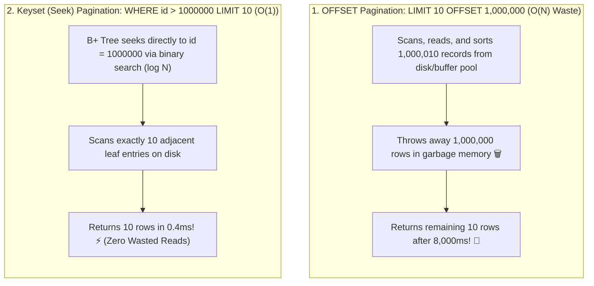

## 🎯 The Question

> **"When paginating through an e-commerce catalog or user table, `SELECT * FROM orders ORDER BY id LIMIT 10 OFFSET 0;` executes in 0.5 ms. But navigating to page 100,000 (`LIMIT 10 OFFSET 1000000;`) takes 8 seconds and pins the database CPU! Why is `OFFSET` so slow, and how do you achieve instant deep pagination?"**

---

## ⚡ 30-Second Elevator Pitch

Developers mistakenly believe that `OFFSET 1000000` tells the database: *"Jump directly to row 1,000,001 on disk."*

At the storage engine level, **a database cannot jump to an arbitrary row offset**:
1. Because rows have variable lengths (text strings, nullable fields) and rows are deleted or updated over time, the database cannot calculate a physical disk byte offset.
2. To satisfy `LIMIT 10 OFFSET 1000000`, the database must:
   - Traverse the B+ Tree index and read **1,000,010 full rows**.
   - Load them into memory.
   - **Discard the first 1,000,000 rows**.
   - Return only the final 10 rows!

As page numbers increase, `OFFSET` scales in **$O(N)$ linear time**, consuming gigabytes of buffer pool memory and saturating disk I/O.

---

## 🧠 Under-the-Hood: OFFSET Discard Waste vs. Keyset Seek



---

## 🔬 The Production Fix: Keyset Pagination (Seek Method)

Instead of telling the database how many rows to skip, tell it **where you left off**:

```sql
-- ❌ BAD: Scans 1,000,010 rows to return 10
SELECT * FROM orders ORDER BY id ASC LIMIT 10 OFFSET 1000000;

-- ✅ PRODUCTION: Direct B+ Tree index seek (Reads exactly 10 rows!)
SELECT * FROM orders WHERE id > 1000000 ORDER BY id ASC LIMIT 10;
```

Because `id` is the indexed primary key, the database performs a **$O(\log N)$ B+ Tree point seek** to key `1000000`, reads the next 10 consecutive rows on that leaf page, and finishes in **0.4 milliseconds**—regardless of whether you are on page 1 or page 1,000,000!

---

## 📌 Comparison Matrix: OFFSET Pagination vs. Keyset Pagination

| Dimension | OFFSET Pagination (`OFFSET 1000000`) | Keyset / Cursor Pagination (`WHERE id > last_id`) |
| :--- | :--- | :--- |
| **Time Complexity** | 🐢 $O(N)$ Linear | ⚡ **$O(1)$ Constant ($O(\log N)$ tree seek)** |
| **Disk & RAM I/O** | Massive (Reads and discards 1M rows) | Minimal (Reads strictly the 10 requested rows) |
| **Page Drift Vulnerability**| 💥 Vulnerable (New inserts cause duplicate/skipped items) | 🛡️ Immune (Strict boundary guarantees consistency) |
| **Random Page Jump** | Can jump to arbitrary "Page 52" | Sequential only ("Next" / "Previous" tokens) |
| **Real-World Standard** | Small internal admin tables (&lt; 1k rows) | **Twitter feed, Infinite scroll, Stripe/Shopify APIs** |

---

## 💡 What Interviewers Ask Next (Follow-Up Traps)

1. **"What if the user wants to sort by a non-unique column like `created_at`?"**
   - *Answer*: Use a **Composite Cursor** combining the timestamp with the unique primary key:
     ```sql
     SELECT * FROM orders 
     WHERE (created_at, id) < ('2026-10-24 12:00:00', 98124)
     ORDER BY created_at DESC, id DESC 
     LIMIT 10;
     ```
     With a composite index `(created_at, id)`, the query maintains $O(1)$ seek performance and breaks timestamp ties deterministically.

2. **"What is the Deferred Join optimization if you MUST use OFFSET?"**
   - *Answer*: If business requirements force arbitrary page numbers, avoid fetching wide columns during the scan. Use a **Deferred Join**:
     ```sql
     SELECT o.* FROM orders o
     JOIN (
         SELECT id FROM orders ORDER BY id LIMIT 10 OFFSET 1000000
     ) sub ON o.id = sub.id;
     ```
     The subquery scans only the compact primary key index without touching heavy table row data, speeding up queries by $5\times$ to $10\times$.

---

:::tip Placement & Interview Takeaway
**Interview Answer**: `OFFSET` degrades performance because the database must fetch and discard all preceding $N$ rows in memory to satisfy the offset count. For scalable pagination, use Keyset (Cursor-based) pagination (`WHERE id > last_seen_id LIMIT 10`), which leverages the B+ Tree index to jump directly to the target record in $O(1)$ constant time.
:::

---

## 📺 Video Explanation

<YouTubeEmbed 
  id="DpcMx2nUGGQ" 
  title="Why OFFSET Kills Database Performance | Backend Interview #88" 
/>
