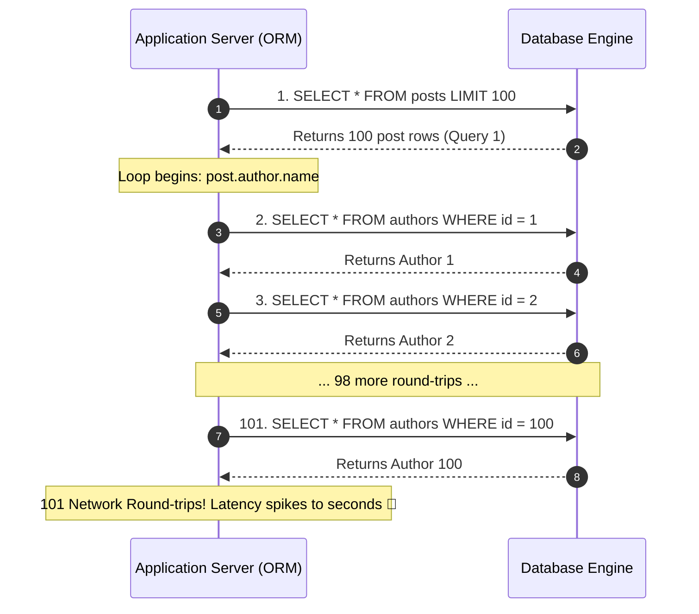

## 🎯 The Question

> **"You write a clean 3-line loop using an ORM (Hibernate, Prisma, Django, or SQLAlchemy) to display 100 blog posts and their authors. Under the hood, your application unexpectedly fires 101 separate SQL queries to the database! What is the N+1 Query Problem, and how do you resolve it?"**

---

## ⚡ 30-Second Elevator Pitch

The **N+1 Query Problem** is the most common database performance killer in ORM-driven applications:

1. **The 1 Initial Query**: The ORM fetches $N$ parent records:
   ```sql
   SELECT * FROM posts LIMIT 100; -- Query #1
   ```
2. **The N Additional Queries (Lazy Loading)**:
   In application code, you loop through the posts to render the author's name:
   ```python
   for post in posts:
       print(post.author.name) # Triggers a separate SQL query for EVERY iteration!
   ```
   Because related entities are **Lazy-Loaded by default**, the ORM fires 100 individual queries:
   ```sql
   SELECT * FROM authors WHERE id = 12;
   SELECT * FROM authors WHERE id = 15;
   -- ... repeated 100 times!
   ```

Instead of 1 fast query, your app executes **$1 + N = 101$ network round-trips**, drowning the database in connection overhead and latency!

---

## 🧠 Under-the-Hood: Lazy Loading Network Storm



---

## 🔬 The Production Fix: Eager Loading

Replace Lazy Loading with **Eager Loading** so the ORM fetches parent and child records together in **1 or 2 queries**:

### Fix 1: Single SQL JOIN (`JOIN FETCH` / `select_related`)
```sql
SELECT p.*, a.* 
FROM posts p 
INNER JOIN authors a ON p.author_id = a.id 
LIMIT 100;
```
* **Django**: `Post.objects.select_related('author').all()`
* **Hibernate (JPA)**: `SELECT p FROM Post p JOIN FETCH p.author`
* **Prisma**: `prisma.post.findMany({ include: { author: true } })`

### Fix 2: Batch `IN` Subquery (`prefetch_related`)
For one-to-many relationships (e.g. 1 post has many comments), joining tables can produce cartesian product row duplication. The ORM fires **exactly 2 queries**:
```sql
SELECT * FROM posts LIMIT 100; -- Query 1
SELECT * FROM comments WHERE post_id IN (1, 2, 3, ... 100); -- Query 2
```
The ORM automatically stitches the comments to their corresponding posts in application memory.

---

## 📌 Comparison Matrix: Lazy Loading vs. Eager Loading

| Metric | Lazy Loading (N+1 Anti-Pattern) | Eager Loading (`JOIN` / `IN (...)`) |
| :--- | :--- | :--- |
| **Total SQL Queries** | **$N + 1$ queries** (e.g. 1,001 queries) | **1 or 2 queries** |
| **Network Round-Trips** | Catastrophic (1,001 network round-trips) | **1 or 2 round-trips** |
| **Database Latency** | Seconds (Connection pool contention) | **A few milliseconds ⚡** |
| **When to Use** | Rarely (Only when related data is seldom accessed) | **Default choice for all list/feed endpoints** |

---

## 💡 What Interviewers Ask Next (Follow-Up Traps)

1. **"Can Eager Loading cause performance problems of its own?"**
   - *Answer*: **Yes! The Cartesian Product Problem**. If an entity has multiple one-to-many child collections (e.g. a Post has 50 Comments AND 20 Tags), joining both in a single SQL query produces $50 \times 20 = 1{,}000$ duplicate rows per post! In Hibernate, this throws a `MultipleBagFetchException`. The fix is to use batch `IN` subqueries (`prefetch_related` / `@BatchSize`) rather than massive multi-table JOINs.

2. **"How do you automatically catch N+1 query bugs before code reaches production?"**
   - *Answer*: Use automated ORM query assertion tools in unit tests:
     - **Django**: `assertNumQueries(2)`
     - **Java/Spring**: `QuickPerf` or `Hypersistence Optimizer`
     - **Node.js**: Prisma query logging or query-counter middleware

---

:::tip Placement & Interview Takeaway
**Interview Answer**: The N+1 query problem occurs when an ORM's lazy loading executes 1 query for parent records and $N$ individual queries for each related child entity in a loop. To fix it, use Eager Loading: use SQL JOINs (`select_related`) for single associations or batch `WHERE id IN (...)` queries (`prefetch_related`) to resolve data in 1 or 2 network trips.
:::

---

## 📺 Video Explanation

<YouTubeEmbed 
  id="b6b2w3COaC0" 
  title="The N+1 Query Problem Explained | Backend Interview #89" 
/>
