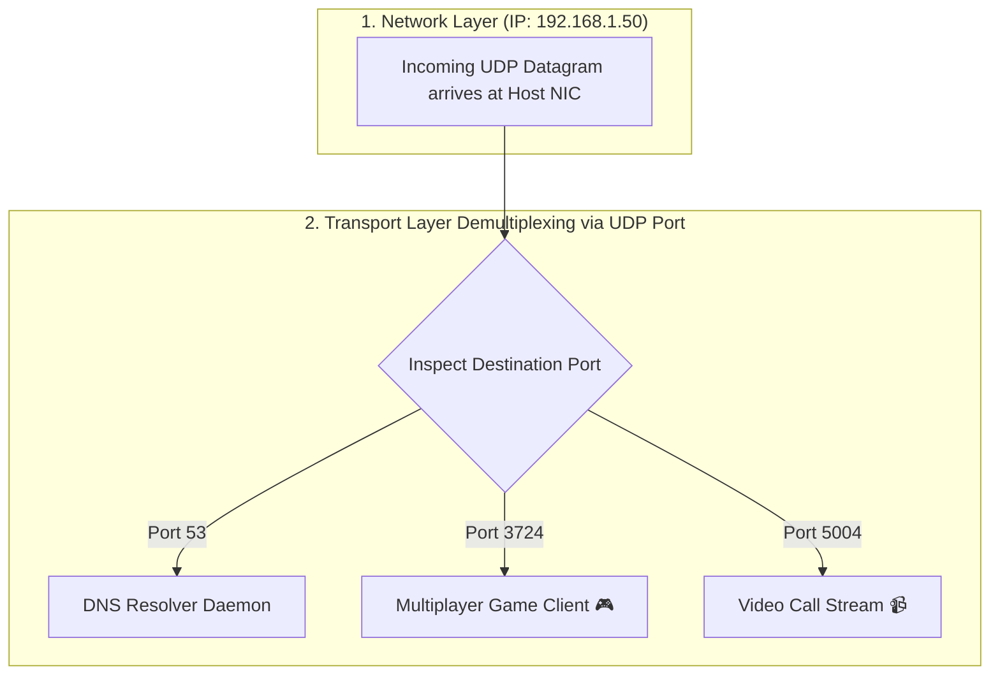

## 🎯 The Question

> **"TCP is connection-oriented, so port numbers make sense to track active connection state. But UDP is connectionless—it sends fire-and-forget datagrams with zero handshakes, zero state, and zero acknowledgments. Why does UDP still require port numbers?"**

---

## ⚡ 30-Second Elevator Pitch

To understand why UDP mandates ports, you must distinguish between the **Network Layer (IP)** and the **Transport Layer (UDP/TCP)**:

* **IP Addresses identify the HOST**:
  The Internet Protocol (Layer 3) routes packets across routers from Source Machine `A` to Destination Machine `B`.
  Once the packet arrives at Machine `B`'s physical network card, IP's job is **100% complete**.
* **Port Numbers identify the PROCESS (Socket)**:
  A single computer runs hundreds of concurrent network programs: Discord voice (UDP), DNS client (UDP 53), a multiplayer video game (UDP), and a streaming video player (UDP).
  Without port numbers, the operating system kernel would have **no idea which application should receive incoming UDP bytes**!

**The Core Principle**: Port numbers enable **Transport Layer Multiplexing (combining data from multiple apps into the network) and Demultiplexing (delivering incoming packets to the correct application socket)**.

---

## 🧠 Under-the-Hood: Transport Layer Demultiplexing

---

## 🔬 TCP Demux (4-Tuple) vs. UDP Demux (2-Tuple)

The operating system handles socket lookup differently between protocols:

* **UDP Demultiplexing uses a 2-Tuple**:
  $$\{\text{Destination IP}, \ \mathbf{Destination\ Port}\}$$
  Any UDP packet arriving with destination port `5004` is delivered to the exact same socket, regardless of which client or IP sent it.
* **TCP Demultiplexing uses a 4-Tuple**:
  $$\{\text{Source IP}, \ \text{Source Port}, \ \text{Destination IP}, \ \text{Destination Port}\}$$
  Each incoming TCP connection has its own dedicated socket descriptor representing that unique point-to-point stream.

---

## 📌 Comparison Matrix: IP Addressing vs. Port Addressing

| Dimension | IP Address (Network Layer 3) | Port Number (Transport Layer 4) |
| :--- | :--- | :--- |
| **What it Identifies** | The physical or virtual **Host Computer** | The specific **Process / Socket** on the host |
| **Address Width** | 32 bits (IPv4) / 128 bits (IPv6) | 16 bits (Ports 0 to 65,535) |
| **Routing Responsibility** | Inter-network routing across routers | Operating system internal kernel demultiplexing |
| **Analogy** | The street address of an apartment building | The specific apartment room number inside |

---

## 💡 What Interviewers Ask Next (Follow-Up Traps)

1. **"What happens if a UDP packet arrives for a port where no application is listening?"**
   - *Answer*: The operating system kernel rejects the packet and sends an **ICMP 'Destination Port Unreachable'** error packet back to the sender. Tools like `traceroute` intentionally leverage this behavior to detect network hops!

2. **"Can multiple applications listen on the exact same UDP port on the same machine?"**
   - *Answer*: By default, **no**—the second `bind()` call throws `EADDRINUSE`. However, modern operating systems support the **`SO_REUSEPORT` socket option**. When enabled, multiple worker processes (like NGINX or Envoy) can bind to the exact same UDP port, and the Linux kernel automatically load-balances incoming datagrams across the worker sockets!

---

:::tip Placement & Interview Takeaway
**Interview Answer**: UDP requires port numbers for Transport Layer Demultiplexing. While an IP address delivers packets to the destination host, port numbers allow the operating system kernel to route incoming datagrams to the specific application socket listening for that traffic.
:::

---

## 📺 Video Explanation

<YouTubeEmbed 
  id="5e_H1Xvlz20" 
  title="Why UDP Needs Ports Without Connections | CS Interview #90" 
/>
